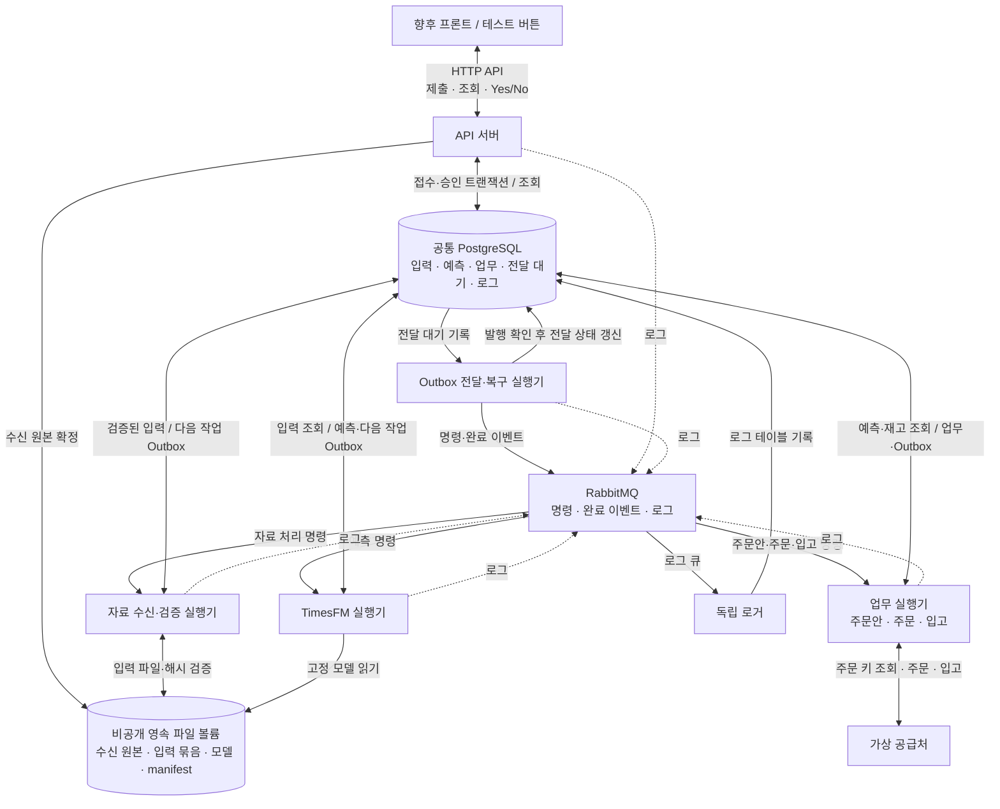

# 1단계 전체 구조와 설계 결정

설계 버전 0.1 · 2026-10-21 · 설계 당시 정책 · 현재 구현·검증은 8단계 참조

구성요소의 책임·통신 경계·현재 연구 코드와의 차이를 정의한다.

[설계 진입점](README.md) · [현재 구현과 검증](08_IMPLEMENTATION.md)

## 설계 결정과 적용 범위

다음은 이번 설계에서 채택한 정책이다. 큐 용량·시간 제한·보존기간 등 수치는 가상 평가의 초기 기본값이며 측정된 처리량이나 성능 보장이 아니다. 변경 시 설정 버전과 변경 사유를 기록한다.

| 결정 | 채택 정책 |
|---|---|
| D01 배포 | 단일 서버 Docker Compose. 역할별 프로세스·컨테이너를 하나의 배포 버전으로 관리한다. |
| D02 브로커 | RabbitMQ 단일 노드와 영속 볼륨을 기본으로 한다. Kafka·Kubernetes·다중 서버는 초기 범위에서 제외한다. |
| D03 DB | 업무·실행 관리·기술 로그를 하나의 PostgreSQL 인스턴스·DB에 두고 테이블·권한을 분리한다. |
| D04 통신 | 명령·완료 이벤트·로그는 큐를 통한다. HTTP 요청·화면 조회·담당 DB 접근·가상 공급처 연동은 각 경로를 사용한다. |
| D05 ML | TimesFM은 큐를 구독하는 독립 실행기다. 입력을 DB에서 직접 읽고 예측을 직접 저장한다. 별도 ML HTTP 서버는 두지 않는다. |
| D06 전달 보장 | 업무 변경과 다음 메시지의 전달 대기 기록을 같은 DB 트랜잭션에 저장한다. Outbox 전달자가 발행한다. |
| D07 중복 | 적어도 한 번 전달될 수 있음을 전제로 한다. 작업 상태·고유 제약·시도 번호로 중복 효과를 차단한다. |
| D08 입력 | 실행별 불변 입력 묶음을 확정한다. 자료 정정과 재실행은 기존 입력·예측을 덮어쓰지 않는다. |
| D09 승인 | 주문안 버전·내용 해시에 대한 명시적 Yes만 인정한다. No·미응답·만료·대체된 주문안은 발주하지 않는다. |
| D10 로그 | 모든 애플리케이션 모듈은 공통 로거 라이브러리로 로그 큐에 발행한다. 독립 로거가 같은 DB에 저장한다. |
| D11 로그 장애 | 기술 로그는 유한 보관·제한된 유실을 허용한다. 업무 승인·주문·입고 이력에는 이 정책을 적용하지 않는다. |
| D12 변경 범위 | 정책·상세 API·DB 명세·구조 SQL은 6단계 문서로 관리한다. 배포 마이그레이션·Compose·실행 서비스 코드는 후속 구현물이다. |

Python 작업 프레임워크와 AMQP 클라이언트, DB·브로커의 정확한 패치 버전은 구현 호환성 검사 후 고정한다. 특정 프레임워크의 임시 작업 결과를 업무 DB 대신 사용하지 않는다.

## 현재 연구 코드와 운영 설계의 경계

| 항목 | 확인된 현재 동작 | 가상 운영 설계 |
|---|---|---|
| 실행 | 과거 개발·평가·정책 비교·보고서 생성 | 확정한 입력으로 한 번 추론하고 주문안 생성 |
| 예측 | 매주 월요일 시작 14일의 일별 예측 | 같은 초기 주기·예측 범위 유지 |
| 과거 목표 | 약품 112일·물품 56일 선택 | 동결한 코호트·순서·문맥 재사용 |
| 환자 | 마지막 28일, 69개 집계 채널 | 같은 집계 의미와 관측 마스크 유지 |
| 달력 | 알려진 달력 16채널 | 원점 당시 알려진 입력·버전 보존 |
| 모델 | 고정 가중치·MPS | 고정 가중치 유지, Linux CPU/CUDA 호환성 검증 필요 |
| 주문 정책 | 매일 검토·납기 1일의 가정 평가 | 7일 검토·품목별 납기의 별도 가상 정책 |

근거는 [현재 실행 파일](../src/methods/timesfm/run.py), [모델 어댑터](../src/methods/timesfm/adapter.py), [연구 설정](../configs/timesfm_vector.json), [실제 실행 계약](../research/methods/TIMESFM_VECTOR_PLAN.md)이다. 7일 실행·14일 예측의 최적성은 비교 검증되지 않았다. 성능으로 선택한 값은 주로 목표 문맥 28·56·112일 중 약품 112일·물품 56일이다. 기존 일별 발주 정책의 안전재고 계수·서비스 성과를 주간 정책으로 이전하지 않는다.

현재 TimesFM 체크포인트는 비상업적·비운영 용도로 제한된 라이선스를 사용한다. 이 설계는 가상 연구·평가에 한정하며 실제 업무 의사결정이나 공급처 연결로 범위를 바꾸기 전에 사용 조건을 별도로 확인한다. [공식 라이선스](https://huggingface.co/google/timesfm-3.0-pytorch/blob/main/LICENSE)

## 전체 구조와 책임

로거의 저장 대상은 PostgreSQL 로그 테이블이다. 그림의 모든 DB 접근은 해당 모듈의 전용 계정을 사용한다. 물리 서버가 하나이므로 컨테이너 분리는 호스트 장애에 대한 고가용성을 제공하지 않는다.

| 역할 | 소유 책임 | 금지되는 책임 |
|---|---|---|
| API | 인증·권한, 제출 접수, 조회, 승인 확정, 접수·승인 Outbox | HTTP 요청 안에서 모델 추론·공급처 전송 |
| 수신·검증 | 일별 입력 검사, 정정 버전, 불변 입력 묶음 확정, 예측 명령 | 누락을 관측 0으로 변경, 환자 원문 로그 |
| TimesFM | 고정 입력 조회, 추론, 결과·실행 상태·다음 명령 저장 | 재고 조정, 승인·주문 변경, 신규 데이터 탐색 polling |
| 업무 | 보호기간·재고 계산, 주문안, 승인된 주문 전송, 접수 확인, 입고 | Yes 없는 발주, 결과 불명 주문의 신규 키 재전송 |
| 전달·복구 | Outbox 발행, 중단 작업 탐지·재개 예약, 보존 정책 실행 | 예측 수량·승인 내용의 임의 변경 |
| 로거 | 큐 로그의 검증·중복 방지·배치 저장 | 업무 상태 결정, 자신의 실패에 대한 무한 로그 발행 |

공통 비즈니스 코드·자료 계약·로거 라이브러리는 재사용하고, ML 의존성이 큰 이미지는 분리할 수 있다. 여섯 애플리케이션 역할과 PostgreSQL·RabbitMQ를 Compose 서비스로 표현하되 별도 물리 서버를 요구하지 않는다. 가상 공급처는 테스트 프로필의 추가 역할이며 외부 서비스에 접속하지 않는다.
