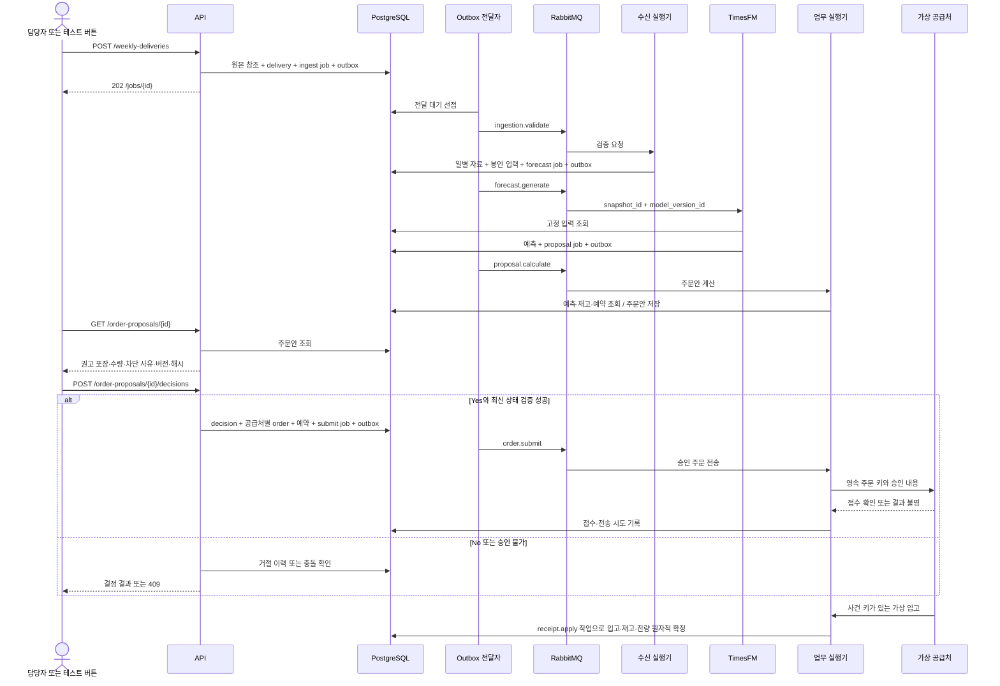

# 업무 로직과 API 및 DB 추적표

명세 버전 0.2 · 2026-10-21 · 명세의 처리 계약이며 실행 서비스 구현은 미완료다.

[설계 진입점](../README.md) · [API 명세](API_SPEC.md) · [DB 구조](DATABASE_SCHEMA.md) · [OpenAPI](openapi.json) · [구조 SQL](schema.sql)

각 업무를 요청·메시지·저장·실패·검증 사례에 연결한다. 아래의 수용 검사는 후속 구현의 완료 기준이다. SQL 생성·제약 검사 통과와 전체 업무 구현 완료를 구분한다.

## 업무 흐름

외부 테스트 API의 입고도 동일한 receipt.apply 경로를 사용한다. 모듈의 모든 애플리케이션 로그는 별도 로그 큐를 거쳐 독립 로거가 app_log에 저장한다.

## 업무 추적표

| ID | 업무 조건 | API 또는 내부 명령 | DB 근거 | 수용 검사 |
|---|---|---|---|---|
| B01 | 최초 112일 이상 이력 준비 | POST /test/scenarios, scenario.bootstrap | scope·artifact·delivery·model_version·model_item·model_feature | 초기 이력 종료일·시드·모델 지원 검사 |
| B02 | 월~일 마감된 7일 자료 제공 | POST /weekly-deliveries | delivery·usage_day·patient_day | 월요일 시작·종료 제외일 7일·완료 선언 |
| B03 | 일별 자료 완전성과 의미 | ingestion.validate | validation_issue·usage_day·patient_day | 30×7 및 69×7 조합·단위·NULL/0 구분 |
| B04 | 반복 실제 기록은 보존 | 제출 집계 계약 | usage_day·artifact | 원천 반복 행을 모두 센 일별 합계 유지 |
| B05 | 동일 제출·요청 재전송 | Idempotency-Key·본문 해시 | api_idempotency·delivery | 같은 키 같은 결과, 다른 내용 409 |
| B06 | 정정 자료 제출 | supersedes_delivery_id | delivery·snapshot_source | 새 revision·같은 기간·현재 유효본 검사 |
| B07 | 과거 입력 고정 | ingestion.validate | input_snapshot·snapshot_target·snapshot_feature | 봉인 후 변경 거부·원점 이후 관측 미포함 |
| B08 | 미래 달력만 알려진 정보 사용 | forecast.generate 입력 | model_feature·snapshot_feature | 발표/가용시각≤knowledge_as_of |
| B09 | 매주 14일 예측 | forecast.generate | forecast_run·forecast_value | 약품·물품 별도, 날짜·품목·분위수 완전성 |
| B10 | 모델 갱신과 추론 구분 | 모델 입력 계약 조회 | model_version·model_item·model_feature | 고정 가중치·장치·해시·전처리·순서 |
| B11 | 최신 상태와 과거 예측 보존 | GET /forecasts, /values | forecast_run·input_snapshot | 이전 결과 불변, 실패를 과거 성공으로 대체 금지 |
| B12 | 현재 재고·기존 주문 확인 | GET /inventory, proposal.calculate | inventory_anchor·inventory_state·external_open_order | 스냅샷과 이후 사건의 이중 반영 금지 |
| B13 | 주간 보호기간·포장 계산 | proposal.calculate | ordering_policy·proposal_line | R+L·도착 전 부족·포장·최소량·0 주문 |
| B14 | 안전재고·단위·납기 불명 차단 | GET /order-proposals/{id} | proposal.blocking_codes·proposal_line | 자료 부족·보호기간>14일 승인 불가 |
| B15 | 주문안 재계산 | POST /order-proposals/{id}/recalculate | proposal·proposal_line·job | 새 버전·기존 승인/주문 불변·예약 반영 |
| B16 | 명시적 Yes | POST /order-proposals/{id}/decisions | decision·purchase_order·order_reservation·outbox | 동시 승인 1회·내용·만료·재고 일치 |
| B17 | No·미응답·만료 | 같은 결정 API·시간 진행 | decision·proposal·business_event | 주문 없음·Outbox 전송 없음·자동 승인 없음 |
| B18 | 전량 0인 권고 | approve 결정 | decision·business_event | order_ids=[]·not_required·공급처 호출 없음 |
| B19 | 여러 공급처 | approve 결정 | purchase_order·purchase_order_line | 양의 라인만 공급처별 1개 주문 |
| B20 | 승인 후 전송 전 변경 | order.submit | proposal·order_reservation·order_attempt | 재검증·전송 보류·예약을 임의 해제하지 않음 |
| B21 | 공급처 접수·응답 유실 | order.submit, POST /purchase-orders/{id}/reconcile | purchase_order·order_attempt | 결과 불명→키 조회·새 키 재주문 금지 |
| B22 | 부분·중복·초과 입고 | POST /purchase-orders/{id}/receipts, receipt.apply | receipt·receipt_line·inventory_event·purchase_order_line | 같은 키 한 번·잔량·단위·주문 라인 검사 |
| B23 | 잘못된 입고 정정 | POST /receipts/{id}/reversals | receipt·receipt_line·inventory_event | 원기록 보존·음수재고 차단·원입고 1회 역분개 |
| B24 | 미입고 주문 중복 연결 | ingestion.validate | external_open_order·purchase_order_line | 같은 원천 주문번호 한 번만 재고위치 계산 |
| B25 | DB와 큐 사이 장애 | Outbox 전달자 | outbox·job·inbox | 커밋 직후 종료·확인 직후 종료·큐 재구성 |
| B26 | 실행기 종료·오래된 결과 | GET /jobs, POST /jobs/{id}/retry | job_attempt·job·outbox | lease·토큰·4회 상한·오래된 결과 거부 |
| B27 | 같은 DB의 큐 로깅 | log.record, GET /logs | app_log | 비식별·16KiB·중복·보존·무한 재귀 없음 |
| B28 | 범위·권한 | Bearer·X-Workspace-ID | principal·membership·scope·복합 FK·RLS | 다른 scope 404·역할403·직접 FK 차단 |
| B29 | 다음 한 주 테스트 | POST /test/scenarios/{id}/weekly-deliveries | scope·job·business_event·inventory_event | expected_version·중복 클릭·일별 순서·일반 경로 |
| B30 | 첫째·둘째 주 예측 평가 | forecast.evaluate, GET /forecasts/{id}/evaluations | forecast_evaluation·evaluation_delivery | 미래 실제값 금지·관측 분모·정정 평가 보존 |
| B31 | 상태 조회·준비 상태 | GET /jobs/{id}, /health/* | job·job_attempt·DB 의존성 | 접수·예측·주문안·접수 확인을 별도 표시 |
| B32 | 백업·복원 후 주문 복구 | 전달·복구 실행기 | outbox·job·order_attempt·불변 입력 | 같은 공급처 키 조회 후 재개·무조건 재전송 금지 |
| B33 | 미전송 보류 주문의 안전한 종료 | POST /purchase-orders/{id}/release | purchase_order·order_reservation·job·business_event | 전송 이력 없음/최종 거절·토큰 무효화·늦은 메시지 차단 |
| B34 | 과거 정정 후 최신 원점 복구 | 제출 상세·최신 주간 전체 정정 제출 | delivery_impact·forecast_run.validity | 영향 대상 표시·새 delivery revision·새 snapshot·새 승인 |
| B35 | 가상 수요 결과 조회 | GET /test/scenarios/{id}/demand-outcomes | demand_outcome·inventory_event | 요청=충족+부족·미래 비공개·중복 진행 1회 |

## 입력 수용 규칙

HTTP 주간 제출은 최대 2 MiB의 JSON 한 묶음으로 확정한다. 이전 설계의 파일별 제출은 이 원본 JSON 내부의 필수 영역으로 구체화한다. 별도 업로드 URL·임의 서버 경로·환자 수준 행은 받지 않는다. bootstrap은 시나리오 실행기만 생성하며 일반 주간 제출 API는 7일분만 받는다.

30품목 프로필은 일별 usage 210행, 환자 집계 483행, 재고 라인 30개를 요구한다. smoke_v1은 약품 3개·물품 3개를 쓰되 환자69·달력16채널 정의는 유지한다. 모든 품목×날짜·특징×날짜 조합이 한 번씩 존재해야 한다. 미관측도 상태를 가진 행으로 제출하므로 무기록을 0으로 해석하지 않는다. patients의 NULL과 observation, usage의 수량·단위·목표 의미를 함께 검사한다.

환자 전체·성별·입원외래·연령은 같은 원천 모집단으로 집계하고 공란 범주를 보존한다. KCD 주상병과 부상병 집계는 고정한 공식 범위를 사용한다. 부상병은 한 환자가 여러 대분류에 등장할 수 있으므로 일괄적으로 전체 환자 수와 합계가 같다고 강제하지 않는다. 모델 입력 계약에는 각 특징의 실제 집계 정의를 보존한다.

정정은 같은 기간을 전체 대체하는 새 revision이다. supersedes_id의 scope·기간·유효본을 확인하고 동일 revision 다른 내용은 거절한다. 검증 성공 커밋에서 이전 validated를 superseded로 바꾸고 새 validated를 확정한다. 새 정정본이 반려되면 이전 유효본을 유지한다. snapshot_source에는 과거 자료 중 채택한 revision만 연결하고 snapshot_target·snapshot_feature에 입력을 복사한다.

목표 입력은 약품112일·물품56일, 환자는28일, known은 최대 문맥112일과 미래14일을 저장한다. 모델 어댑터에서 환자28일 밖은 마스크를 적용한다. target 날짜는 원점 전날까지, patient도 원점 전날까지다. 미래 관측값은 source_available_at과 실제 사건일 모두 검사해 배제한다. 가상 source_available_at과 실제 received_at은 별도이며, 순수 합성 평가에서만 시나리오 시각을 자료 가용시각으로 사용한다.

과거 주간 정정이 더 최신 snapshot의 문맥을 바꾸면 snapshot_source 역참조로 모든 영향 원점을 찾는다. 기존 예측 수량은 유지하고 forecast_run.validity=input_revised로 표시하며 미승인 주문안을 무효화한다. 현재 승인 가능 기간의 최신 원점은 delivery_impact.waiting_resubmission, 지난 원점은 historical_only로 기록한다. 제출 상세의 correction_impacts 및 작업 result.required_resubmission_delivery_ids로 복구 대상을 반환한다. 원래 최신 주간을 전체 자료·새 source_revision·supersedes_delivery_id로 재제출하면 새 delivery이므로 새 snapshot·forecast를 만들 수 있다. resolution_delivery_id로 대체 제출을 연결하고, 새 snapshot이 정정본을 참조하는 유효 대체 파이프라인이 완료된 뒤 impact.resolved를 확정한다. 과거 정정만으로 과거 원점의 새 운영 주문안을 만들지 않는다. 승인 기한이 지난 원점은 다음 정상 주간부터 정정된 과거를 사용한다.

model_version이 validated가 아니거나 고정 manifest·필수 달력의 버전/발표 근거가 없으면 예측을 시작하지 않는다. 현재 보존된 정부 달력은 2020~2024 범위이므로 2026 예시를 실행할 때 이를 그대로 재사용했다고 표시하지 않는다. 시나리오는 합성 달력임을 표시하거나 평가 날짜에 유효한 공식 참조를 별도로 준비해야 한다.

## 트랜잭션과 상태 전이

### T01 접수와 시나리오 생성

원본 파일을 비공개 불변 위치에 확정한 후 DB에 artifact·delivery·ingest job·outbox·api_idempotency·business_event를 함께 커밋한다. 접수 중 같은 키의 경쟁 요청은 주체·범위·키의 DB 잠금과 고유 제약으로 한 번만 확정한다. 승인·입고 등 다른 POST도 응답 저장을 같은 업무 트랜잭션에 포함한다. 커밋 결과가 불명확하면 클라이언트는 같은 키로 재조회한다.

새 시나리오는 플랫폼 test_admin만 만든다. scope·호출자의 viewer/uploader/approver/operator/admin/receiver/test_operator/log_reader membership·bootstrap job·Outbox·접수 응답을 함께 저장한다. 신규 scope 이전의 멱등성은 별도 scenario_creation_request가 principal_id·request_key로 보장한다. 해당 키를 트랜잭션 잠금으로 직렬화하고 새 scope 식별자 생성→SET LOCAL→scope·하위 기록·전역 응답 행 순서로 한 번만 커밋한다. 이 전역 테이블은 API의 시나리오 생성 기능만 접근하며 다른 주체의 결과를 반환하지 않는다.

### T02 검증과 입력 봉인

수신 실행기가 원본·범위·모델·원천 버전을 확인한다. 정정 유효본 교체·영향 조회와 snapshot 봉인은 모두 승인과 같은 scope 선행 잠금을 사용한다. 트랜잭션 안에서 채택하려는 모든 원천 revision이 여전히 validated인지 다시 검사한 뒤 snapshot_source·입력 복사·봉인·영향 무효화를 직렬화한다. 구 revision을 사전에 읽었더라도 이 재검사를 통과하기 전 봉인하지 않는다. 검증 실패는 validation_issue·delivery.rejected·job.blocked·업무 이력으로 확정하고 모델 작업을 발행하지 않는다. 성공은 짧은 트랜잭션에서 입력 일관성·정정 교체·snapshot 봉인·pending forecast_run·forecast job·Outbox·inbox를 확정한다. snapshot 자식 쓰기와 봉인은 부모 잠금으로 직렬화한다.

### T03 예측 확정

job_attempt의 유효 fencing_token과 실행 상태를 확인한 뒤 모델을 실행한다. 시작 시 snapshot_source의 현재 유효 revision과 delivery_impact를 검사한다. 정정 영향이 있으면 validity=input_revised를 유지·설정하고 운영 주문안 연결을 차단한다. 추론 동안 DB 잠금을 유지하지 않는다. 성공 결과는 모든 등록 품목×14일이 있고 유한값·9개 분위수의 오름차순·q50·비음수 후처리가 일치해야 한다. 모두 검사한 뒤 동일 scope 선행 잠금과 유효 토큰 아래 forecast_value·forecast_run.succeeded·job.succeeded·inbox를 같은 트랜잭션에 확정한다. 완료 시에도 원천 revision·정정 영향을 재검사하고 validity를 무조건 current로 덮어쓰지 않는다. input_revised이면 결과는 과거 계산 이력으로만 보존하고 proposal job·Outbox를 생성하지 않는다. 유효한 current 입력에만 다음 proposal 작업을 연결한다. 한 코호트라도 실패하면 전체 예측을 failed로 표시하고 주문안을 만들지 않는다. 부분 출력으로 과거 결과나 naive를 대입하지 않는다.

### T04 주문안과 정책 변경

재계산은 scope와 관련 품목을 고정 순서로 잠그고 forecast의 입력 정정 여부·최신 재고 버전·정책·미입고·예약을 읽는다. 이전 pending/blocked 주문안을 superseded로 바꾼 뒤 새 버전을 저장한다. 이미 approved인 주문안과 주문 기록은 바꾸지 않는다. 예측 자체가 과거 정정으로 대체되었으면 새 예측 완료 전 주문안을 생성하지 않는다.

품목의 새 ordering_policy는 item 잠금으로 expected_version·공급처·포장·valid_from을 검사한다. 초기 달력 규칙은 calendar_days·모든 요일·Asia/Seoul·도착00:00만 허용하며 HH:MM의 시 범위는 00~23이다. 기존 정책은 불변이다. 정책 적용시각이 주문안 결정시각에 영향을 주면 미승인 주문안을 만료시키고, 미전송 주문은 전송 직전 재검증에서 보류한다. 이미 전송한 주문의 정책을 바꾸지 않는다. 정책 등록과 관련 무효화 이력은 같은 트랜잭션에 저장한다.

### T05 Yes와 No

scope→품목 ID 오름차순→proposal 순서로 잠근다. 인증 주체·내용 해시·버전·pending·만료·재고와 정책·입력 유효성을 확인한다. Yes는 decision·공급처별 양의 purchase_order·라인·reservation·submit job·Outbox·업무 이력·멱등 응답을 함께 커밋한다. No는 decision.reject·proposal.rejected·업무 이력·멱등 응답만 커밋한다. SQL의 approve 결정 참조는 No에 대한 주문 생성을 구조적으로 차단한다.

주문안의 expires_at과 next_demand_at은 가상 시간 기준이다. 실제 작업 lease와 혼용하지 않는다. 전 품목 0이면 승인 기록만 남기고 주문이나 submit Outbox는 생성하지 않는다. 초기 전체 승인에서 차단 품목이 하나라도 있으면 Yes를 거절한다. 품목 부분 제외는 초기 미지원이며 차단 사유 해소 후 전체 명단의 새 버전을 검토한다.

### T06 전송과 결과 불명

짧은 트랜잭션에서 승인·해시·기간·입력 정정·정책·재고·기존 주문을 재검사하고 sending 및 전송 토큰을 확보한다. 외부 통신에는 DB 잠금을 잡지 않는다. stale이면 blocked와 원인을 남기고 예약을 조용히 해제하지 않는다. operator가 release의 안전 조건을 확인하여 기존 주문 의도를 종료한 뒤 재계산·새 승인을 진행한다.

응답 유실·실행기 종료·공급처 성공 후 DB 오류는 결과 불명이다. 복구 실행기가 sending lease 만료를 찾아 reconcile 작업을 만든다. 공급처 조회가 not_found를 확정할 때만 동일 order_key·content_hash로 재전송한다. 조회 실패는 unknown을 유지한다. 새 키는 사용하지 않는다. 같은 품목에 미해소 주문이 있으면 추가 승인을 차단한다.

release는 blocked이며 submit 시작 이력이 전혀 없는 주문 또는 공급처의 명시적 최종 rejected만 허용한다. scope와 order를 잠그고 전송 토큰·대기 submit 작업을 무효화하며 reservation.remaining_units=0·released와 해제자·시각·사유·업무 이력을 원자적으로 기록한다. 미전송 의도는 voided가 되며 이미 최종 거절된 주문은 rejected를 유지한다. 늦게 도착한 큐 메시지는 상태·토큰 검사로 전송하지 않는다. sending/unknown/accepted 및 과거 전송 뒤 not_found만 확인된 주문은 지연 도착 위험 때문에 이 API로 해제하지 않는다. 실제 공급처 취소 기능은 초기 범위가 아니다. GET 주문 라인의 remaining_units는 유효 미입고 수량으로 정의하며 voided 또는 최종 rejected 후 해제된 주문은 0을 반환한다. 저장된 ordered_units·received_units·cancelled_units는 역사 수량으로 유지하고 공급처 취소가 있었다고 만들어내지 않는다.

### T07 입고와 역분개

API는 accepted 주문·입고 키·라인의 동일 주문·단위·양의 수량을 확인하고 received 상태의 receipt와 job·Outbox를 저장한다. 실제 반영 때 scope→order→order_line ID 순서→inventory_state ID 순서로 잠그고, 합계가 잔량을 넘지 않는지 다시 검사한다. receipt.applied·received_units·reservation 잔량·inventory_event·inventory_state·부분 입고 상태·inbox·업무 이력을 함께 확정한다. 입고 접수 202 시점에는 재고가 늘지 않는다. occurred_at이 scope.simulation_at보다 미래이거나 주문 accepted_at 이전이면 422로 거절한다. 발생시각이 현재 anchor.as_of 이하이면 주문 입고·잔량만 반영하고 inventory_event.stock_effect=false로 기록하여 현재 재고에 다시 가산하지 않는다. 기준점 이후 사건만 실제 투영한다. 어느 경우든 입고 변화는 관련 미승인 주문안의 기준을 무효화한다.

같은 source_receipt_key는 동일 주문 안에서 본문 해시가 같을 때 기존 결과를 반환한다. 다른 주문은 독립 키 공간이다. 같은 키 다른 내용은 409다. 같은 주문 라인을 하나의 receipt에서 두 번 제출할 수 없다. 역분개는 applied 상태의 일반 원입고(reverses_receipt_id IS NULL) 라인 전체를 한 번만 뒤집고 이후 유효 수량을 다시 계산한다. 원입고시각≤역분개시각≤scope.simulation_at을 검사하고 역분개의 역분개는 거절한다. 재고가 음수이거나 원 입고가 이미 역분개되었으면 차단한다. 미래 역분개는 거절하고, 원 입고 이후 새 기준점이 적용되어 현재 재고효과를 확정할 수 없으면 ANCHOR_RECONCILIATION_REQUIRED로 차단한다. 기준점 이전 입고의 자동 역분개는 초기 미지원이다. 원 입고 삭제나 주문 취소로 처리하지 않는다.

### T08 주간 진행과 재고 기준점

테스트 API는 scope를 잠그고 next_week_start·version·active_job을 확인한다. 같은 주간 작업이 있으면 기존 작업을 반환한다. 새 요청만 advancing 상태와 simulate job을 만들고 active_week_start에 대상 주간을 선점한다. 같은 작업의 복구는 동일 사건 키로 진행한다. simulate→일반 수신→예측→주문안 생성의 유효 자식 작업이 완료되어야 업무 실행기가 ready·active_job 해제를 확정한다. 진단용 blocked 주문안의 생성 완료는 파이프라인 완료로 볼 수 있지만 예측·수신 작업 자체의 실패는 복구 실행기가 scope.failed로 표시하고 다음 주 진행을 막는다. 실패 단계는 일반 재시도 정책을 따르며 최대 시도 소진·자료 오류는 원인 수정 또는 새 독립 시나리오에서 검증한다.

advancing 중 input_revised로 예측이 끝나 proposal 명령이 생기지 않으면 복구 실행기는 scope.failed와 blocking_code=CORRECTION_RESUBMISSION_REQUIRED를 기록한다. 아직 발생하지 않은 proposal을 영원히 기다리지 않는다. waiting_resubmission에 해당하는 최신 주간 정정본이 접수되면 같은 scope 잠금 아래 active_job을 대체 ingest 파이프라인으로 연결하고 active_week_start는 유지한다. 새 작업은 기존 active_job을 parent로 참조하며 delivery_impact.resolution_delivery_id로 복구 근거를 연결한다. 이미 지난 주간을 복구하는 경우에도 이 대체 파이프라인을 사용하고 과거 소비를 다시 실행하지 않는다.

대체 파이프라인의 새 current 예측·주문안이 성공하면 마지막 단계가 같은 scope 잠금 아래 last_completed_week_start를 확인한다. active_week_start가 next_week_start와 같고 아직 완료 기록이 없을 때만 next_week_start를 7일·version을 1회 증가시키고 last_completed_week_start를 기록한다. 해당 주간이 이미 완료되었으면 ready로 복구하되 주차·진행 version을 추가 증가시키지 않는다. 정정 재제출 실패는 scope.failed·복구 참조를 유지하며 주차를 늘리지 않는다. resolved는 해당 새 snapshot이 정정본을 참조하고 유효 파이프라인이 완료된 시점에 확정한다. API 시나리오 조회는 active_week_start·last_completed_week_start·blocking_code를 반환한다.

시뮬레이터는 일별로 예정 입고→사용 가능한 주문 검토·전송 결과→수요 처리→재고·부족 기록 순서를 고정한다. 같은 업무 실행기의 입고·재고 반영 함수를 재사용하고 자기 큐의 receipt.apply 결과를 동기 대기하지 않는다. 외부 API 입고와 같은 검증·트랜잭션을 적용하되 중복 작업·사건을 만들지 않는다. 한 주 실행 중 확정한 일별 사건키와 진행일을 DB에 남겨 중단 후 같은 날을 두 번 소비하지 않는다. 미래 합성 정답 전체를 TimesFM에 노출하지 않는다. 미응답 주문안은 첫 보호 대상 수요를 처리하기 전에 만료시키고 주문하지 않는다. 주간 마감 후 정상 제출과 동일한 원본·검증 경로로 자료를 넘기며, 큐 수신 작업이 다음 큐 단계의 완료를 동기 대기하지 않는다.

새 재고 anchor는 그 기준시각까지의 입고·소비를 이미 포함한다. 이후 사건만 상태에 적용한다. 주간 실제값을 읽어 과거 소비를 다시 차감하지 않는다. 원장의 예상과 제공 스냅샷 차이는 adjustment 사건과 근거로 남긴다. 기존 내부 주문과 연결한 external_open_order는 한 번만 포함하고, 연결되지 않은 최신 외부 주문 관측도 가용시각·상태·입고 예정일로 제한한다. 과거 정정의 오래된 anchor는 기록만 보존하고 현재 재고를 과거로 되돌리지 않는다. 현재와 같거나 더 최신인 anchor를 확정할 때는 해당 기준점 수량에서 이후 재고 사건을 순서대로 재투영하고 state 버전을 증가시킨다. 음수·누락·잔량 불일치는 자동 보정하지 않고 차단한다.

각 처리일은 demand_outcome에 requested_units·fulfilled_units·lost_units와 사건키를 기록하며 requested=fulfilled+lost를 보장한다. 가상 usage_day에는 실제 재고에서 충족하여 사용된 수량을 전달하고, 미충족 요청은 별도로 보존한다. 결품으로 사용량이 제한된 상황에서 사용량 예측을 잠재 수요 예측이라고 부르지 않는다. 실제 소비가 0이어도 전부 미충족인 수요 결과 행은 남긴다. 해당 결과는 미래 일자를 생성·노출하기 전에 업무 시각을 검사하고 /demand-outcomes는 처리 완료 일자만 반환한다.

### T09 실제값 평가와 로그

새 validated 자료가 들어오면 해당 날짜와 겹치는 성공 예측의 evaluate 작업을 만든다. 예측 1~7일·8~14일을 품목별로 따로 평가하고 관측된 실제값 수·7일 분모·실제값 revision 해시를 저장한다. 완성 전은 pending, 평가 시점에 전혀 관측되지 않는 경우는 unavailable과 이유를 남긴다. 수정 실제값은 새 truth_hash 결과로 보존한다. API의 window는 DB evaluation_window에 매핑한다. 평가지표의 API id는 forecast_evaluation.id이고 실제값 source는 evaluation_delivery로 연결한다. 현재 평가 결과는 evaluated_at·id 정렬로 선택하고 truth_hash 필터가 있으면 해당 보존 버전을 반환한다.

로거는 event_id 중복을 흡수하고 저장 커밋 후 ack한다. 기술 로그가 유실되어도 job·business_event·승인·주문·입고는 남는다. 로그 정리 계정은 app_log만 삭제할 수 있고 입력·업무 기록은 삭제하지 않는다. 로거 자신의 DB 오류를 동일 로그 큐에 반복 발행하지 않는다.

## 구조 SQL과 서비스 구현의 구분

schema.sql은 테이블·자료형·FK·고유키·CHECK·부분 인덱스·scope RLS·봉인 입력 보호 트리거를 정의한다. 상태 전이·범위별 권한 부여·내용 해시 계산·행 간 합계·순서·실행 토큰 검사·공급처 조회는 위 T01~T09를 구현하는 서비스/DB 함수가 필요하다. 모든 업무 데이터 변경의 짧은 확정 트랜잭션은 scope 선행 잠금을 공유한다. heartbeat·Outbox 발행 선점 등 실행 관리 갱신은 별도 짧은 잠금으로 처리하며 장시간 추론·외부 통신에는 scope 잠금을 잡지 않는다. 이 파일만 적용해도 비즈니스 로직 전체가 동작한다고 표현하지 않는다.

순환 참조가 있는 경우 식별자를 먼저 생성하고 parent scope·작업→입력/주문/입고 자원→연결 필드 순서로 같은 트랜잭션 안에서 기록한다. job.resource_id와 business_event.aggregate_id는 유형별 식별자이므로 선언적 FK를 두지 않으며 stage/type별 실제 자원 존재·범위를 서비스 계약에서 확인한다. 이 예외를 일반 데이터 FK 생략의 근거로 사용하지 않는다.

구조 SQL 검증에는 독립된 임시 PostgreSQL만 사용한다. 연구 DB·개인 자료를 적재하거나 현재 연구 산출물을 변경하지 않는다. OpenAPI 스키마 검사·예시 검사는 HTTP 구현 테스트와 구분한다.
