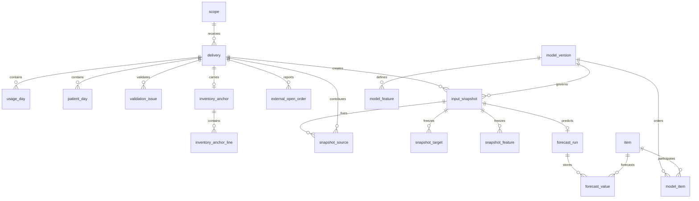
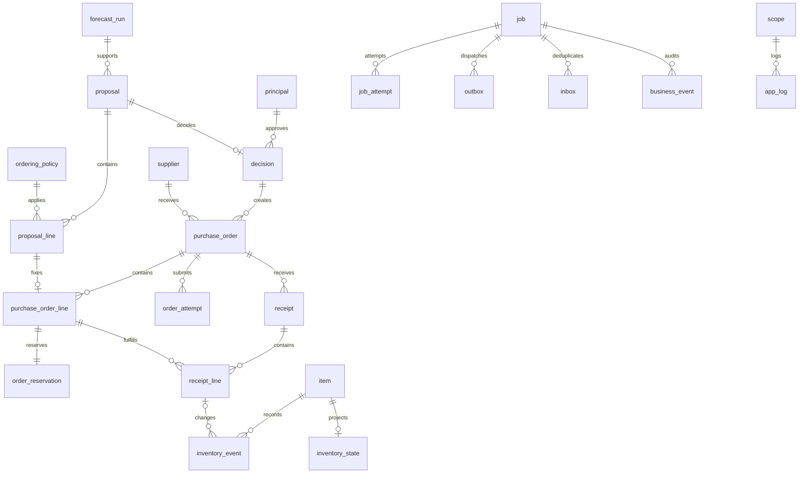
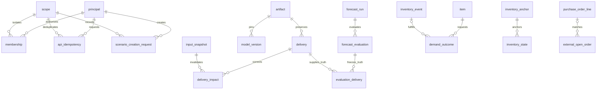

# DB 테이블 구조와 관계도

명세 버전 0.2 · 2026-10-21 · 설계 SQL이며 운영 migration이 아니다.

[설계 진입점](../README.md) · [API 명세](API_SPEC.md) · [전체 DDL](schema.sql)

하나의 PostgreSQL DB 안에 app 스키마를 사용한다. 로그도 app.app_log에 저장한다. scope는 병원·창고·가상 시나리오 하나를 뜻한다. 모든 범위 데이터는 scope_id와 복합 FK로 다른 시나리오와 섞이지 않게 한다.

## 공통 자료형과 격리

- PK는 UUID, 시간은 timestamptz, 업무 날짜는 date다. 수량·예측값은 numeric(20,6)이며 API에서는 소수 문자열로 전달한다. app.quantity는 비음수이며 NaN을 금지한다.
- 기본 id·created_at 외의 NULL 허용 여부·기본값·CHECK·고유 제약은 아래 표와 schema.sql을 따른다. FK 삭제는 기본 NO ACTION으로 연결 자료를 보호한다.
- 인증 서비스가 토큰 주체와 membership을 확인한 뒤 트랜잭션마다 SET LOCAL app.scope_id를 설정한다. 클라이언트 헤더를 검증 없이 SQL 세션 설정으로 사용하지 않는다. 연결 풀 반환 시 범위가 남지 않도록 한다.
- RLS를 강제하지만 superuser/BYPASSRLS 계정은 실행기에 주지 않는다. 전역 복구는 등록된 scope를 하나씩 선택하여 처리한다. principal은 인증 관리만 쓰고 일반 사용자가 전체 조회하지 못한다.
- 같은 scope의 자원이라도 품목·주문·예측이 같은 승인 근거인지 확인하는 업무 검사는 아래 트랜잭션 계약에서 추가한다.

## 테이블 목록

| 테이블 | 역할 | 쓰기 소유자 |
|---|---|---|
| `scope` | 병원·창고별 가상 시나리오와 진행 잠금 | 테스트 제어 |
| `principal` | 검증한 인증 주체의 참조 | 인증 관리 |
| `membership` | 범위별 접근 권한 | 인증 관리 |
| `artifact` | 비공개 원본·모델·manifest 파일 참조 | API·등록 관리 |
| `supplier` | 가상 공급처 등록 | 관리 |
| `item` | 약품·물품의 고정 식별과 단위 | 관리 |
| `ordering_policy` | 품목별 불변 발주 정책 버전 | 관리 |
| `model_version` | 고정 모델·장치·전처리 계약 | 관리 |
| `model_item` | 모델별 코호트·품목 순서 | 관리 |
| `model_feature` | 69개 환자·16개 알려진 특징의 정의와 순서 | 관리 |
| `delivery` | 주간 또는 초기 이력 제출·정정 revision | API·수신 |
| `validation_issue` | 집계·파일·필드 검증 오류 | 수신 |
| `usage_day` | 제출 revision별 일별 수량 | 수신 |
| `patient_day` | 식별값 없는 일별 환자 집계 | 수신 |
| `inventory_anchor` | 기준시각의 권위 있는 재고 스냅샷 | 수신·업무 |
| `inventory_anchor_line` | 기준 재고 품목별 수량 | 수신 |
| `external_open_order` | 제출별 외부 미입고 주문 관측 | 수신·업무 |
| `input_snapshot` | 불변 모델 입력 묶음 | 수신 |
| `snapshot_source` | 입력에 사용한 제출 revision 목록 | 수신 |
| `snapshot_target` | 실행별 동결 목표 입력 복사 | 수신 |
| `snapshot_feature` | 동결 환자·알려진 달력 입력 | 수신 |
| `job` | 비동기 단계별 작업과 복구 상태 | 담당 실행기·복구 |
| `job_attempt` | 작업 시도와 fencing token | 담당 실행기·복구 |
| `outbox` | 업무 커밋과 결합된 전달 대기 메시지 | 생산 모듈·전달자 |
| `inbox` | 소비 완료 메시지 중복 방지 | 각 소비자 |
| `api_idempotency` | API 재요청 응답과 본문 해시 | API |
| `forecast_run` | 한 snapshot의 공동 예측 실행 | TimesFM |
| `forecast_value` | 원점·품목·대상일별 예측 | TimesFM |
| `inventory_state` | 품목별 현재 재고 투영과 버전 | 수신·업무 |
| `inventory_event` | 실제·가상 재고 사건의 불변 원장 | 업무 |
| `proposal` | 주문안 버전과 승인 유효성 | 업무·API 상태 전이 |
| `proposal_line` | 품목별 권고·재고·정책 근거 | 업무 |
| `decision` | 주문안 버전·내용에 대한 불변 Yes/No | API |
| `purchase_order` | 공급처별 주문 의도와 접수 상태 | API 생성·업무 전송 |
| `purchase_order_line` | 승인한 수량과 품목의 발주 라인 | API 생성·업무 입고 |
| `order_reservation` | 미전송·미확인 주문의 중복발주 예약 | API·업무 |
| `order_attempt` | 전송·접수조회 시도와 불명 결과 | 업무 |
| `receipt` | 입고 통지와 정정 사건 | API 접수·업무 적용 |
| `receipt_line` | 라인별 실제 입고량 | 업무 |
| `business_event` | 기술 로그와 분리한 업무 상태 이력 | 변경 주체 |
| `app_log` | 같은 PostgreSQL의 구조화 기술 로그 | 로거 |
| `forecast_evaluation` | 지연 도착 실제값으로 첫째·둘째 주 정확도 평가 | 업무 평가 |
| `evaluation_delivery` | 평가 실제값의 제출 revision 추적 | 업무 평가 |
| `scenario_creation_request` | 새 scope 생성 전역 멱등성 기록 | API test_admin 전용 |
| `delivery_impact` | 과거 정정으로 영향을 받은 원점과 재제출 복구 | 수신 |
| `demand_outcome` | 가상 품목별 일별 요청·충족·부족 결과 | 시뮬레이터 |

## 테이블별 컬럼과 제약

### scope

병원·창고별 가상 시나리오와 진행 잠금.

| 컬럼 | SQL 자료형과 NULL 및 기본값 | 의미 |
|---|---|---|
| `id` | `uuid PRIMARY KEY DEFAULT gen_random_uuid()` | 행 식별자 |
| `hospital_code` | `text NOT NULL` | 병원 코드 |
| `warehouse_code` | `text NOT NULL` | 창고 코드 |
| `name` | `text NOT NULL` | 시나리오 이름 |
| `status` | `text NOT NULL DEFAULT 'bootstrapping'` | bootstrapping ready advancing failed |
| `seed` | `bigint NOT NULL` | 합성자료 시드 |
| `simulation_at` | `timestamptz NOT NULL` | 가상 업무 시각 |
| `next_week_start` | `date NOT NULL` | 다음 전달 주간 월요일 |
| `version` | `bigint NOT NULL DEFAULT 1` | 낙관적 잠금 버전 |
| `profile` | `jsonb NOT NULL` | 합성 초기 재고·생성 규칙·가상 공급처 설정 |
| `model_version_id` | `uuid` | 시나리오 고정 모델 |
| `active_job_id` | `uuid` | 현재 bootstrap 또는 simulate/정정 대체 작업 |
| `active_week_start` | `date` | 진행 또는 복구 중인 주간 |
| `last_completed_week_start` | `date` | 정상 주차 증가가 완료된 마지막 주간 |
| `blocking_code` | `text` | 정정 재제출·파이프라인 실패 사유 |
| `created_at` | `timestamptz NOT NULL DEFAULT now()` | 실제 UTC 생성시각 |

CHECK: `status IN ('bootstrapping','ready','advancing','failed')`; `version > 0`; `extract(isodow from next_week_start)=1`.

FK: `(id, model_version_id) → model_version(scope_id, id)`; `(id, active_job_id) → job(scope_id, id)`.

### principal

검증한 인증 주체의 참조.

| 컬럼 | SQL 자료형과 NULL 및 기본값 | 의미 |
|---|---|---|
| `id` | `uuid PRIMARY KEY DEFAULT gen_random_uuid()` | 행 식별자 |
| `subject` | `text NOT NULL UNIQUE` | 토큰 검증 후 주체 |
| `kind` | `text NOT NULL` | human service |
| `disabled` | `boolean NOT NULL DEFAULT false` | 비활성화 |
| `platform_role` | `text NOT NULL DEFAULT 'none' CHECK (platform_role IN ('none','test_admin'))` | 새 가상 범위 생성 권한 |
| `created_at` | `timestamptz NOT NULL DEFAULT now()` | 실제 UTC 생성시각 |

CHECK: `kind IN ('human','service')`.

### membership

범위별 접근 권한.

| 컬럼 | SQL 자료형과 NULL 및 기본값 | 의미 |
|---|---|---|
| `id` | `uuid PRIMARY KEY DEFAULT gen_random_uuid()` | 행 식별자 |
| `scope_id` | `uuid NOT NULL` | 병원·창고·가상 시나리오 범위 |
| `principal_id` | `uuid NOT NULL` | 주체 |
| `role` | `text NOT NULL` | viewer uploader approver operator admin receiver test_operator log_reader |
| `created_at` | `timestamptz NOT NULL DEFAULT now()` | 실제 UTC 생성시각 |

공통 고유키: `(scope_id, id)`.

추가 고유키: `(scope_id, principal_id, role)`.

CHECK: `role IN ('viewer','uploader','approver','operator','admin','receiver','test_operator','log_reader')`.

FK: `(scope_id) → scope(id)`; `(principal_id) → principal(id)`.

### artifact

비공개 원본·모델·manifest 파일 참조.

| 컬럼 | SQL 자료형과 NULL 및 기본값 | 의미 |
|---|---|---|
| `id` | `uuid PRIMARY KEY DEFAULT gen_random_uuid()` | 행 식별자 |
| `scope_id` | `uuid NOT NULL` | 병원·창고·가상 시나리오 범위 |
| `kind` | `text NOT NULL` | delivery model manifest synthetic_truth |
| `storage_key` | `text NOT NULL` | 서버 발급 상대 경로 |
| `sha256` | `app.sha256 NOT NULL` | 불변 파일 해시 |
| `byte_count` | `bigint NOT NULL` | 바이트 수 |
| `media_type` | `text NOT NULL` | 콘텐츠 유형 |
| `access_class` | `text NOT NULL` | input model simulator_only |
| `created_at` | `timestamptz NOT NULL DEFAULT now()` | 실제 UTC 생성시각 |

공통 고유키: `(scope_id, id)`.

추가 고유키: `(scope_id, storage_key)`.

CHECK: `byte_count >= 0`; `kind IN ('delivery','model','manifest','synthetic_truth')`; `access_class IN ('input','model','simulator_only')`.

FK: `(scope_id) → scope(id)`.

### supplier

가상 공급처 등록.

| 컬럼 | SQL 자료형과 NULL 및 기본값 | 의미 |
|---|---|---|
| `id` | `uuid PRIMARY KEY DEFAULT gen_random_uuid()` | 행 식별자 |
| `scope_id` | `uuid NOT NULL` | 병원·창고·가상 시나리오 범위 |
| `code` | `text NOT NULL` | 공급처 코드 |
| `name` | `text NOT NULL` | 공급처명 |
| `adapter` | `text NOT NULL CHECK (adapter='synthetic')` | 초기에는 가상 연동만 허용 |
| `created_at` | `timestamptz NOT NULL DEFAULT now()` | 실제 UTC 생성시각 |

공통 고유키: `(scope_id, id)`.

추가 고유키: `(scope_id, code)`.

FK: `(scope_id) → scope(id)`.

### item

약품·물품의 고정 식별과 단위.

| 컬럼 | SQL 자료형과 NULL 및 기본값 | 의미 |
|---|---|---|
| `id` | `uuid PRIMARY KEY DEFAULT gen_random_uuid()` | 행 식별자 |
| `scope_id` | `uuid NOT NULL` | 병원·창고·가상 시나리오 범위 |
| `code` | `text NOT NULL` | 문자열 품목 코드 |
| `name` | `text NOT NULL` | 실제 또는 가상 품목명 |
| `kind` | `text NOT NULL` | drug material |
| `base_unit` | `text NOT NULL` | 예측·재고 기본 단위 |
| `target_semantics` | `text NOT NULL` | drug_record_units material_issue_units |
| `active` | `boolean NOT NULL DEFAULT true` | 주문 취급 상태 |
| `created_at` | `timestamptz NOT NULL DEFAULT now()` | 실제 UTC 생성시각 |

공통 고유키: `(scope_id, id)`.

추가 고유키: `(scope_id, code)`.

CHECK: `(kind='drug' AND target_semantics='drug_record_units') OR (kind='material' AND target_semantics='material_issue_units')`.

FK: `(scope_id) → scope(id)`.

### ordering_policy

품목별 불변 발주 정책 버전.

| 컬럼 | SQL 자료형과 NULL 및 기본값 | 의미 |
|---|---|---|
| `id` | `uuid PRIMARY KEY DEFAULT gen_random_uuid()` | 행 식별자 |
| `scope_id` | `uuid NOT NULL` | 병원·창고·가상 시나리오 범위 |
| `item_id` | `uuid NOT NULL` | 품목 |
| `supplier_id` | `uuid NOT NULL` | 가상 공급처 |
| `version` | `integer NOT NULL` | 정책 버전 |
| `review_days` | `integer NOT NULL DEFAULT 7` | 검토 주기 |
| `lead_days` | `integer NOT NULL` | 초기 가상 달력일 납기 |
| `pack_size` | `app.quantity NOT NULL` | 포장당 기본 단위 |
| `minimum_packs` | `integer NOT NULL` | 양의 발주 시 최소 포장 수 |
| `safety_units` | `app.quantity NOT NULL` | 검증 조건을 표시한 가상 안전재고 |
| `valid_from` | `timestamptz NOT NULL` | 가상 업무 적용 시작 |
| `calendar_rule` | `jsonb NOT NULL CHECK (calendar_rule->>'mode'='calendar_days')` | 초기 달력일·마감·도착시각 규칙 |
| `policy_hash` | `app.sha256 NOT NULL` | 정책 내용 해시 |
| `created_at` | `timestamptz NOT NULL DEFAULT now()` | 실제 UTC 생성시각 |

공통 고유키: `(scope_id, id)`.

추가 고유키: `(scope_id, item_id, version)`, `(scope_id, id, item_id)`.

CHECK: `version > 0`; `review_days = 7`; `lead_days >= 1`; `pack_size > 0`; `minimum_packs >= 1`.

FK: `(scope_id) → scope(id)`; `(scope_id, item_id) → item(scope_id, id)`; `(scope_id, supplier_id) → supplier(scope_id, id)`.

### model_version

고정 모델·장치·전처리 계약.

| 컬럼 | SQL 자료형과 NULL 및 기본값 | 의미 |
|---|---|---|
| `id` | `uuid PRIMARY KEY DEFAULT gen_random_uuid()` | 행 식별자 |
| `scope_id` | `uuid NOT NULL` | 병원·창고·가상 시나리오 범위 |
| `name` | `text NOT NULL` | 모델 버전명 |
| `checkpoint_revision` | `text NOT NULL` | 체크포인트 revision |
| `checkpoint_artifact_id` | `uuid NOT NULL` | 체크포인트 파일 |
| `code_commit` | `text NOT NULL` | 추론 코드 버전 |
| `image_digest` | `text NOT NULL` | 컨테이너 고정 이미지 |
| `backend` | `text NOT NULL` | cpu cuda mps |
| `horizon_days` | `integer NOT NULL DEFAULT 14` | 예측 범위 |
| `drug_context_days` | `integer NOT NULL DEFAULT 112` | 약품 문맥 |
| `material_context_days` | `integer NOT NULL DEFAULT 56` | 물품 문맥 |
| `patient_context_days` | `integer NOT NULL DEFAULT 28` | 환자 문맥 |
| `expected_drugs` | `integer NOT NULL DEFAULT 20` | 목표 약품 수 |
| `expected_materials` | `integer NOT NULL DEFAULT 10` | 목표 물품 수 |
| `expected_patients` | `integer NOT NULL DEFAULT 69` | 환자 채널 수 |
| `expected_known` | `integer NOT NULL DEFAULT 16` | 알려진 채널 수 |
| `manifest` | `jsonb NOT NULL` | 라이선스·해시·마스크·중앙값·장치 검증 |
| `status` | `text NOT NULL` | registered validated disabled |
| `created_at` | `timestamptz NOT NULL DEFAULT now()` | 실제 UTC 생성시각 |

공통 고유키: `(scope_id, id)`.

추가 고유키: `(scope_id, name)`.

CHECK: `backend IN ('cpu','cuda','mps')`; `status IN ('registered','validated','disabled')`; `horizon_days=14`; `drug_context_days=112`; `material_context_days=56`; `patient_context_days=28`; `expected_drugs > 0 AND expected_materials > 0 AND expected_patients=69 AND expected_known=16`.

FK: `(scope_id) → scope(id)`; `(scope_id, checkpoint_artifact_id) → artifact(scope_id, id)`.

### model_item

모델별 코호트·품목 순서.

| 컬럼 | SQL 자료형과 NULL 및 기본값 | 의미 |
|---|---|---|
| `id` | `uuid PRIMARY KEY DEFAULT gen_random_uuid()` | 행 식별자 |
| `scope_id` | `uuid NOT NULL` | 병원·창고·가상 시나리오 범위 |
| `model_version_id` | `uuid NOT NULL` | 모델 |
| `item_id` | `uuid NOT NULL` | 품목 |
| `cohort` | `text NOT NULL CHECK (cohort IN ('drug','material'))` | 별도 예측 벡터 |
| `ordinal` | `integer NOT NULL CHECK (ordinal >= 0)` | 벡터 순서 |
| `created_at` | `timestamptz NOT NULL DEFAULT now()` | 실제 UTC 생성시각 |

공통 고유키: `(scope_id, id)`.

추가 고유키: `(scope_id, model_version_id, item_id)`, `(scope_id, model_version_id, cohort, ordinal)`.

FK: `(scope_id) → scope(id)`; `(scope_id, model_version_id) → model_version(scope_id, id)`; `(scope_id, item_id) → item(scope_id, id)`.

### model_feature

69개 환자·16개 알려진 특징의 정의와 순서.

| 컬럼 | SQL 자료형과 NULL 및 기본값 | 의미 |
|---|---|---|
| `id` | `uuid PRIMARY KEY DEFAULT gen_random_uuid()` | 행 식별자 |
| `scope_id` | `uuid NOT NULL` | 병원·창고·가상 시나리오 범위 |
| `model_version_id` | `uuid NOT NULL` | 모델 |
| `kind` | `text NOT NULL CHECK (kind IN ('patient','known'))` | 과거 환자·과거미래 달력 |
| `feature_key` | `text NOT NULL` | 동결한 특징명 |
| `ordinal` | `integer NOT NULL CHECK (ordinal >= 0)` | 특징 순서 |
| `definition` | `jsonb NOT NULL` | 성별·연령·공식 KCD 경계·집계 정의 |
| `created_at` | `timestamptz NOT NULL DEFAULT now()` | 실제 UTC 생성시각 |

공통 고유키: `(scope_id, id)`.

추가 고유키: `(scope_id, model_version_id, kind, feature_key)`, `(scope_id, model_version_id, kind, ordinal)`.

FK: `(scope_id) → scope(id)`; `(scope_id, model_version_id) → model_version(scope_id, id)`.

### delivery

주간 또는 초기 이력 제출·정정 revision.

| 컬럼 | SQL 자료형과 NULL 및 기본값 | 의미 |
|---|---|---|
| `id` | `uuid PRIMARY KEY DEFAULT gen_random_uuid()` | 행 식별자 |
| `scope_id` | `uuid NOT NULL` | 병원·창고·가상 시나리오 범위 |
| `kind` | `text NOT NULL` | bootstrap weekly |
| `week_start` | `date NOT NULL` | 시작일 |
| `week_end_exclusive` | `date NOT NULL` | 종료 제외일 |
| `source_revision` | `integer NOT NULL` | 원천 전체 대체 버전 |
| `supersedes_id` | `uuid` | 이전 같은 기간 제출 |
| `source_closed_at` | `timestamptz NOT NULL` | 마감 시각 |
| `source_available_at` | `timestamptz NOT NULL` | 가용 시각 |
| `received_at` | `timestamptz NOT NULL` | 실제 접수 시각 |
| `schema_version` | `integer NOT NULL DEFAULT 1` | 입력 스키마 |
| `model_version_id` | `uuid NOT NULL` | 접수 시 고정한 모델 |
| `artifact_id` | `uuid NOT NULL` | 원본 JSON 파일 |
| `body_hash` | `app.sha256 NOT NULL` | 정규화 요청 해시 |
| `status` | `text NOT NULL` | received validating validated rejected superseded |
| `submitted_by` | `uuid NOT NULL` | 접수 주체 |
| `validation_completed_at` | `timestamptz` | 검증 완료 |
| `created_at` | `timestamptz NOT NULL DEFAULT now()` | 실제 UTC 생성시각 |

공통 고유키: `(scope_id, id)`.

추가 고유키: `(scope_id, week_start, week_end_exclusive, source_revision)`.

CHECK: `kind IN ('bootstrap','weekly')`; `status IN ('received','validating','validated','rejected','superseded')`; `source_revision > 0`; `week_end_exclusive > week_start`; `kind <> 'weekly' OR (week_end_exclusive=week_start+7 AND extract(isodow from week_start)=1)`; `source_available_at >= source_closed_at`.

FK: `(scope_id) → scope(id)`; `(scope_id, model_version_id) → model_version(scope_id, id)`; `(scope_id, supersedes_id) → delivery(scope_id, id)`; `(scope_id, artifact_id) → artifact(scope_id, id)`; `(submitted_by) → principal(id)`.

### validation_issue

집계·파일·필드 검증 오류.

| 컬럼 | SQL 자료형과 NULL 및 기본값 | 의미 |
|---|---|---|
| `id` | `uuid PRIMARY KEY DEFAULT gen_random_uuid()` | 행 식별자 |
| `scope_id` | `uuid NOT NULL` | 병원·창고·가상 시나리오 범위 |
| `delivery_id` | `uuid NOT NULL` | 제출 |
| `item_id` | `uuid` | 관련 품목 |
| `code` | `text NOT NULL` | 오류 코드 |
| `field_path` | `text NOT NULL` | 환자 원문 없는 필드 경로 |
| `severity` | `text NOT NULL CHECK (severity IN ('warning','error'))` | 심각도 |
| `detail` | `jsonb NOT NULL` | 집계 오류 정보 |
| `created_at` | `timestamptz NOT NULL DEFAULT now()` | 실제 UTC 생성시각 |

공통 고유키: `(scope_id, id)`.

FK: `(scope_id) → scope(id)`; `(scope_id, delivery_id) → delivery(scope_id, id)`; `(scope_id, item_id) → item(scope_id, id)`.

### usage_day

제출 revision별 일별 수량.

| 컬럼 | SQL 자료형과 NULL 및 기본값 | 의미 |
|---|---|---|
| `id` | `uuid PRIMARY KEY DEFAULT gen_random_uuid()` | 행 식별자 |
| `scope_id` | `uuid NOT NULL` | 병원·창고·가상 시나리오 범위 |
| `delivery_id` | `uuid NOT NULL` | 자료 버전 |
| `item_id` | `uuid NOT NULL` | 품목 |
| `day` | `date NOT NULL` | 사용·출고 날짜 |
| `quantity` | `app.quantity` | 미관측은 NULL |
| `observation` | `text NOT NULL` | observed missing not_applicable |
| `unit` | `text NOT NULL` | 기본 단위 |
| `available_at` | `timestamptz NOT NULL` | 자료 가용시각 |
| `created_at` | `timestamptz NOT NULL DEFAULT now()` | 실제 UTC 생성시각 |

공통 고유키: `(scope_id, id)`.

추가 고유키: `(scope_id, delivery_id, item_id, day)`.

CHECK: `(observation='observed' AND quantity IS NOT NULL) OR (observation IN ('missing','not_applicable') AND quantity IS NULL)`.

FK: `(scope_id) → scope(id)`; `(scope_id, delivery_id) → delivery(scope_id, id)`; `(scope_id, item_id) → item(scope_id, id)`.

### patient_day

식별값 없는 일별 환자 집계.

| 컬럼 | SQL 자료형과 NULL 및 기본값 | 의미 |
|---|---|---|
| `id` | `uuid PRIMARY KEY DEFAULT gen_random_uuid()` | 행 식별자 |
| `scope_id` | `uuid NOT NULL` | 병원·창고·가상 시나리오 범위 |
| `delivery_id` | `uuid NOT NULL` | 자료 버전 |
| `feature_key` | `text NOT NULL` | 69채널 특징 키 |
| `day` | `date NOT NULL` | 집계 날짜 |
| `value` | `bigint` | 관측된 수 |
| `observation` | `text NOT NULL` | observed missing |
| `available_at` | `timestamptz NOT NULL` | 자료 가용시각 |
| `created_at` | `timestamptz NOT NULL DEFAULT now()` | 실제 UTC 생성시각 |

공통 고유키: `(scope_id, id)`.

추가 고유키: `(scope_id, delivery_id, feature_key, day)`.

CHECK: `(observation='observed' AND value IS NOT NULL AND value>=0) OR (observation='missing' AND value IS NULL)`.

FK: `(scope_id) → scope(id)`; `(scope_id, delivery_id) → delivery(scope_id, id)`.

### inventory_anchor

기준시각의 권위 있는 재고 스냅샷.

| 컬럼 | SQL 자료형과 NULL 및 기본값 | 의미 |
|---|---|---|
| `id` | `uuid PRIMARY KEY DEFAULT gen_random_uuid()` | 행 식별자 |
| `scope_id` | `uuid NOT NULL` | 병원·창고·가상 시나리오 범위 |
| `delivery_id` | `uuid NOT NULL` | 제출 |
| `as_of` | `timestamptz NOT NULL` | 소비·입고를 포함한 기준시각 |
| `source_version` | `text NOT NULL` | 원천 재고 버전 |
| `status` | `text NOT NULL CHECK (status IN ('received','applied','rejected'))` | 반영 상태 |
| `created_at` | `timestamptz NOT NULL DEFAULT now()` | 실제 UTC 생성시각 |

공통 고유키: `(scope_id, id)`.

추가 고유키: `(scope_id, delivery_id)`.

FK: `(scope_id) → scope(id)`; `(scope_id, delivery_id) → delivery(scope_id, id)`.

### inventory_anchor_line

기준 재고 품목별 수량.

| 컬럼 | SQL 자료형과 NULL 및 기본값 | 의미 |
|---|---|---|
| `id` | `uuid PRIMARY KEY DEFAULT gen_random_uuid()` | 행 식별자 |
| `scope_id` | `uuid NOT NULL` | 병원·창고·가상 시나리오 범위 |
| `anchor_id` | `uuid NOT NULL` | 기준 재고 |
| `item_id` | `uuid NOT NULL` | 품목 |
| `on_hand` | `app.quantity NOT NULL` | 보유 |
| `unavailable` | `app.quantity NOT NULL` | 사용불가 |
| `allocated` | `app.quantity NOT NULL` | 소비 예약 |
| `unit` | `text NOT NULL` | 기본 단위 |
| `created_at` | `timestamptz NOT NULL DEFAULT now()` | 실제 UTC 생성시각 |

공통 고유키: `(scope_id, id)`.

추가 고유키: `(scope_id, anchor_id, item_id)`.

CHECK: `unavailable+allocated <= on_hand`.

FK: `(scope_id) → scope(id)`; `(scope_id, anchor_id) → inventory_anchor(scope_id, id)`; `(scope_id, item_id) → item(scope_id, id)`.

### external_open_order

제출별 외부 미입고 주문 관측.

| 컬럼 | SQL 자료형과 NULL 및 기본값 | 의미 |
|---|---|---|
| `id` | `uuid PRIMARY KEY DEFAULT gen_random_uuid()` | 행 식별자 |
| `scope_id` | `uuid NOT NULL` | 병원·창고·가상 시나리오 범위 |
| `delivery_id` | `uuid NOT NULL` | 제출 |
| `supplier_id` | `uuid NOT NULL` | 공급처 |
| `source_order_key` | `text NOT NULL` | 원천 주문 키 |
| `source_line_key` | `text NOT NULL` | 원천 라인 키 |
| `item_id` | `uuid NOT NULL` | 품목 |
| `remaining_units` | `app.quantity NOT NULL` | 미입고 기본 수량 |
| `unit` | `text NOT NULL` | 기본 단위 |
| `expected_at` | `timestamptz NOT NULL` | 입고 예정 |
| `matched_order_line_id` | `uuid` | 내부 주문과 연결 |
| `status` | `text NOT NULL CHECK (status IN ('open','cancelled','unknown'))` | 관측 상태 |
| `created_at` | `timestamptz NOT NULL DEFAULT now()` | 실제 UTC 생성시각 |

공통 고유키: `(scope_id, id)`.

추가 고유키: `(scope_id, delivery_id, supplier_id, source_order_key, source_line_key)`.

FK: `(scope_id) → scope(id)`; `(scope_id, delivery_id) → delivery(scope_id, id)`; `(scope_id, supplier_id) → supplier(scope_id, id)`; `(scope_id, item_id) → item(scope_id, id)`; `(scope_id, matched_order_line_id, item_id) → purchase_order_line(scope_id, id, item_id)`.

### input_snapshot

불변 모델 입력 묶음.

| 컬럼 | SQL 자료형과 NULL 및 기본값 | 의미 |
|---|---|---|
| `id` | `uuid PRIMARY KEY DEFAULT gen_random_uuid()` | 행 식별자 |
| `scope_id` | `uuid NOT NULL` | 병원·창고·가상 시나리오 범위 |
| `delivery_id` | `uuid NOT NULL` | 최신 주간 제출 |
| `model_version_id` | `uuid NOT NULL` | 모델 계약 |
| `forecast_origin` | `date NOT NULL` | 월요일 예측 원점 |
| `cutoff_at` | `timestamptz NOT NULL` | 사건 자료 사용 종료 제외시각 |
| `knowledge_as_of` | `timestamptz NOT NULL` | 입력 가용성 판단시각 |
| `status` | `text NOT NULL CHECK (status IN ('building','sealed','invalid'))` | 봉인 상태 |
| `manifest_hash` | `app.sha256 NOT NULL` | 입력·순서·마스크 해시 |
| `sealed_at` | `timestamptz` | 봉인시각 |
| `created_at` | `timestamptz NOT NULL DEFAULT now()` | 실제 UTC 생성시각 |

공통 고유키: `(scope_id, id)`.

추가 고유키: `(scope_id, delivery_id, model_version_id)`, `(scope_id, id, model_version_id)`.

CHECK: `(status='sealed')=(sealed_at IS NOT NULL)`; `cutoff_at <= knowledge_as_of`.

FK: `(scope_id) → scope(id)`; `(scope_id, delivery_id) → delivery(scope_id, id)`; `(scope_id, model_version_id) → model_version(scope_id, id)`.

### snapshot_source

입력에 사용한 제출 revision 목록.

| 컬럼 | SQL 자료형과 NULL 및 기본값 | 의미 |
|---|---|---|
| `id` | `uuid PRIMARY KEY DEFAULT gen_random_uuid()` | 행 식별자 |
| `scope_id` | `uuid NOT NULL` | 병원·창고·가상 시나리오 범위 |
| `snapshot_id` | `uuid NOT NULL` | 입력 묶음 |
| `delivery_id` | `uuid NOT NULL` | 참조 자료 |
| `start_day` | `date NOT NULL` | 사용 시작 |
| `end_day_exclusive` | `date NOT NULL` | 사용 종료 제외 |
| `created_at` | `timestamptz NOT NULL DEFAULT now()` | 실제 UTC 생성시각 |

공통 고유키: `(scope_id, id)`.

추가 고유키: `(scope_id, snapshot_id, delivery_id)`.

CHECK: `end_day_exclusive > start_day`.

FK: `(scope_id) → scope(id)`; `(scope_id, snapshot_id) → input_snapshot(scope_id, id)`; `(scope_id, delivery_id) → delivery(scope_id, id)`.

### snapshot_target

실행별 동결 목표 입력 복사.

| 컬럼 | SQL 자료형과 NULL 및 기본값 | 의미 |
|---|---|---|
| `id` | `uuid PRIMARY KEY DEFAULT gen_random_uuid()` | 행 식별자 |
| `scope_id` | `uuid NOT NULL` | 병원·창고·가상 시나리오 범위 |
| `snapshot_id` | `uuid NOT NULL` | 입력 묶음 |
| `model_version_id` | `uuid NOT NULL` | 모델 계약 |
| `item_id` | `uuid NOT NULL` | 품목 |
| `day` | `date NOT NULL` | 입력 날짜 |
| `quantity` | `app.quantity` | 목표 |
| `observation` | `text NOT NULL` | 관측 상태 |
| `created_at` | `timestamptz NOT NULL DEFAULT now()` | 실제 UTC 생성시각 |

공통 고유키: `(scope_id, id)`.

추가 고유키: `(scope_id, snapshot_id, item_id, day)`.

CHECK: `(observation='observed' AND quantity IS NOT NULL) OR (observation IN ('missing','not_applicable') AND quantity IS NULL)`.

FK: `(scope_id) → scope(id)`; `(scope_id, snapshot_id, model_version_id) → input_snapshot(scope_id, id, model_version_id)`; `(scope_id, model_version_id, item_id) → model_item(scope_id, model_version_id, item_id)`.

### snapshot_feature

동결 환자·알려진 달력 입력.

| 컬럼 | SQL 자료형과 NULL 및 기본값 | 의미 |
|---|---|---|
| `id` | `uuid PRIMARY KEY DEFAULT gen_random_uuid()` | 행 식별자 |
| `scope_id` | `uuid NOT NULL` | 병원·창고·가상 시나리오 범위 |
| `snapshot_id` | `uuid NOT NULL` | 입력 묶음 |
| `model_version_id` | `uuid NOT NULL` | 모델 계약 |
| `kind` | `text NOT NULL CHECK (kind IN ('patient','known'))` | 입력 종류 |
| `feature_key` | `text NOT NULL` | 특징 키 |
| `day` | `date NOT NULL` | 입력 날짜 |
| `value` | `app.finite_number` | 특징값 |
| `observation` | `text NOT NULL` | observed missing |
| `announced_at` | `timestamptz` | 달력·정책 당시 발표시각 |
| `created_at` | `timestamptz NOT NULL DEFAULT now()` | 실제 UTC 생성시각 |

공통 고유키: `(scope_id, id)`.

추가 고유키: `(scope_id, snapshot_id, kind, feature_key, day)`.

CHECK: `(observation='observed' AND value IS NOT NULL) OR (observation='missing' AND value IS NULL)`.

FK: `(scope_id) → scope(id)`; `(scope_id, snapshot_id, model_version_id) → input_snapshot(scope_id, id, model_version_id)`; `(scope_id, model_version_id, kind, feature_key) → model_feature(scope_id, model_version_id, kind, feature_key)`.

### job

비동기 단계별 작업과 복구 상태.

| 컬럼 | SQL 자료형과 NULL 및 기본값 | 의미 |
|---|---|---|
| `id` | `uuid PRIMARY KEY DEFAULT gen_random_uuid()` | 행 식별자 |
| `scope_id` | `uuid NOT NULL` | 병원·창고·가상 시나리오 범위 |
| `parent_job_id` | `uuid` | 상위 workflow |
| `stage` | `text NOT NULL` | bootstrap ingest forecast proposal submit reconcile receipt simulate evaluate |
| `resource_id` | `uuid NOT NULL` | stage별 원천 자원 식별자 |
| `dedupe_key` | `text NOT NULL` | 단계·자원·버전의 고유 키 |
| `status` | `text NOT NULL` | queued running succeeded retry_wait failed blocked |
| `current_attempt` | `integer NOT NULL DEFAULT 0` | 유효 시도 번호 |
| `next_retry_at` | `timestamptz` | 다음 예약 |
| `error_code` | `text` | 원문 없는 최종 오류 |
| `result` | `jsonb NOT NULL DEFAULT '{}'` | 생성 자원 참조 |
| `updated_at` | `timestamptz NOT NULL DEFAULT now()` | 실제 상태 변경시각 |
| `created_at` | `timestamptz NOT NULL DEFAULT now()` | 실제 UTC 생성시각 |

공통 고유키: `(scope_id, id)`.

추가 고유키: `(scope_id, dedupe_key)`.

CHECK: `stage IN ('bootstrap','ingest','forecast','proposal','submit','reconcile','receipt','simulate','evaluate')`; `status IN ('queued','running','succeeded','retry_wait','failed','blocked')`; `current_attempt BETWEEN 0 AND 4`.

FK: `(scope_id) → scope(id)`; `(scope_id, parent_job_id) → job(scope_id, id)`.

### job_attempt

작업 시도와 fencing token.

| 컬럼 | SQL 자료형과 NULL 및 기본값 | 의미 |
|---|---|---|
| `id` | `uuid PRIMARY KEY DEFAULT gen_random_uuid()` | 행 식별자 |
| `scope_id` | `uuid NOT NULL` | 병원·창고·가상 시나리오 범위 |
| `job_id` | `uuid NOT NULL` | 작업 |
| `number` | `integer NOT NULL CHECK (number BETWEEN 1 AND 4)` | 시도 번호 |
| `fencing_token` | `uuid NOT NULL` | 유효 쓰기 토큰 |
| `status` | `text NOT NULL CHECK (status IN ('running','succeeded','failed','abandoned'))` | 시도 상태 |
| `started_at` | `timestamptz NOT NULL` | 시작 |
| `heartbeat_at` | `timestamptz NOT NULL` | 생존 확인 |
| `lease_until` | `timestamptz NOT NULL` | 선점 만료 |
| `finished_at` | `timestamptz` | 종료 |
| `error_code` | `text` | 실패 종류 |
| `created_at` | `timestamptz NOT NULL DEFAULT now()` | 실제 UTC 생성시각 |

공통 고유키: `(scope_id, id)`.

추가 고유키: `(scope_id, job_id, number)`, `(scope_id, fencing_token)`.

FK: `(scope_id) → scope(id)`; `(scope_id, job_id) → job(scope_id, id)`.

### outbox

업무 커밋과 결합된 전달 대기 메시지.

| 컬럼 | SQL 자료형과 NULL 및 기본값 | 의미 |
|---|---|---|
| `id` | `uuid PRIMARY KEY DEFAULT gen_random_uuid()` | 행 식별자 |
| `scope_id` | `uuid NOT NULL` | 병원·창고·가상 시나리오 범위 |
| `job_id` | `uuid NOT NULL` | 대상 작업 |
| `message_id` | `uuid NOT NULL` | 재발행해도 같은 메시지 ID |
| `attempt` | `integer NOT NULL CHECK (attempt BETWEEN 1 AND 4)` | 대상 실행 시도 |
| `message_type` | `text NOT NULL` | 명령·이벤트 타입 |
| `routing_key` | `text NOT NULL` | 큐 라우팅 |
| `payload` | `jsonb NOT NULL` | 참조만 포함한 envelope |
| `status` | `text NOT NULL CHECK (status IN ('pending','leased','published','held'))` | 발행 상태 |
| `available_at` | `timestamptz NOT NULL` | 예약시각 |
| `lease_token` | `uuid` | 전달 선점 |
| `lease_until` | `timestamptz` | 선점 만료 |
| `published_at` | `timestamptz` | 발행 확인 |
| `publish_count` | `integer NOT NULL DEFAULT 0 CHECK (publish_count>=0)` | 발행 시도 횟수 |
| `created_at` | `timestamptz NOT NULL DEFAULT now()` | 실제 UTC 생성시각 |

공통 고유키: `(scope_id, id)`.

추가 고유키: `(scope_id, message_id)`.

FK: `(scope_id) → scope(id)`; `(scope_id, job_id) → job(scope_id, id)`.

### inbox

소비 완료 메시지 중복 방지.

| 컬럼 | SQL 자료형과 NULL 및 기본값 | 의미 |
|---|---|---|
| `id` | `uuid PRIMARY KEY DEFAULT gen_random_uuid()` | 행 식별자 |
| `scope_id` | `uuid NOT NULL` | 병원·창고·가상 시나리오 범위 |
| `consumer` | `text NOT NULL` | 논리 소비자명 |
| `message_id` | `uuid NOT NULL` | 수신 메시지 |
| `job_id` | `uuid NOT NULL` | 작업 |
| `attempt` | `integer NOT NULL` | 시도 |
| `processed_at` | `timestamptz NOT NULL` | 업무 커밋 시각 |
| `created_at` | `timestamptz NOT NULL DEFAULT now()` | 실제 UTC 생성시각 |

공통 고유키: `(scope_id, id)`.

추가 고유키: `(scope_id, consumer, message_id)`.

FK: `(scope_id) → scope(id)`; `(scope_id, job_id) → job(scope_id, id)`.

### api_idempotency

API 재요청 응답과 본문 해시.

| 컬럼 | SQL 자료형과 NULL 및 기본값 | 의미 |
|---|---|---|
| `id` | `uuid PRIMARY KEY DEFAULT gen_random_uuid()` | 행 식별자 |
| `scope_id` | `uuid NOT NULL` | 병원·창고·가상 시나리오 범위 |
| `principal_id` | `uuid NOT NULL` | 주체 |
| `method_path` | `text NOT NULL` | HTTP method와 실제 경로 |
| `request_key` | `text NOT NULL` | Idempotency-Key |
| `request_hash` | `app.sha256 NOT NULL` | 정규화 본문 |
| `http_status` | `integer NOT NULL CHECK (http_status BETWEEN 200 AND 599)` | 원 응답 상태 |
| `response_body` | `jsonb NOT NULL` | 비식별 응답 |
| `location` | `text` | 생성 자원 |
| `created_at` | `timestamptz NOT NULL DEFAULT now()` | 실제 UTC 생성시각 |

공통 고유키: `(scope_id, id)`.

추가 고유키: `(scope_id, principal_id, method_path, request_key)`.

FK: `(scope_id) → scope(id)`; `(principal_id) → principal(id)`.

### forecast_run

한 snapshot의 공동 예측 실행.

| 컬럼 | SQL 자료형과 NULL 및 기본값 | 의미 |
|---|---|---|
| `id` | `uuid PRIMARY KEY DEFAULT gen_random_uuid()` | 행 식별자 |
| `scope_id` | `uuid NOT NULL` | 병원·창고·가상 시나리오 범위 |
| `snapshot_id` | `uuid NOT NULL` | 고정 입력 |
| `model_version_id` | `uuid NOT NULL` | 모델 |
| `job_id` | `uuid NOT NULL` | 예측 작업 |
| `status` | `text NOT NULL CHECK (status IN ('pending','running','succeeded','failed'))` | 예측 상태 |
| `validity` | `text NOT NULL DEFAULT 'current' CHECK (validity IN ('current','input_revised'))` | 입력 정정의 영향 |
| `generated_at` | `timestamptz` | 실제 생성시각 |
| `manifest` | `jsonb NOT NULL DEFAULT '{}'` | 장치·실행시간·메모리·해시 |
| `created_at` | `timestamptz NOT NULL DEFAULT now()` | 실제 UTC 생성시각 |

공통 고유키: `(scope_id, id)`.

추가 고유키: `(scope_id, snapshot_id)`, `(scope_id, job_id)`, `(scope_id, id, model_version_id)`.

FK: `(scope_id) → scope(id)`; `(scope_id, snapshot_id, model_version_id) → input_snapshot(scope_id, id, model_version_id)`; `(scope_id, job_id) → job(scope_id, id)`.

### forecast_value

원점·품목·대상일별 예측.

| 컬럼 | SQL 자료형과 NULL 및 기본값 | 의미 |
|---|---|---|
| `id` | `uuid PRIMARY KEY DEFAULT gen_random_uuid()` | 행 식별자 |
| `scope_id` | `uuid NOT NULL` | 병원·창고·가상 시나리오 범위 |
| `forecast_id` | `uuid NOT NULL` | 예측 실행 |
| `model_version_id` | `uuid NOT NULL` | 모델 |
| `item_id` | `uuid NOT NULL` | 품목 |
| `target_day` | `date NOT NULL` | 대상일 |
| `horizon_day` | `integer NOT NULL CHECK (horizon_day BETWEEN 1 AND 14)` | 1~14 |
| `prediction_raw` | `app.finite_number NOT NULL` | 원 중앙값 |
| `prediction` | `app.quantity NOT NULL` | max 0 중앙값 |
| `quantiles` | `numeric(20,6)[] NOT NULL CHECK (cardinality(quantiles)=9)` | q10~q90 |
| `created_at` | `timestamptz NOT NULL DEFAULT now()` | 실제 UTC 생성시각 |

공통 고유키: `(scope_id, id)`.

추가 고유키: `(scope_id, forecast_id, item_id, target_day)`.

FK: `(scope_id) → scope(id)`; `(scope_id, forecast_id, model_version_id) → forecast_run(scope_id, id, model_version_id)`; `(scope_id, model_version_id, item_id) → model_item(scope_id, model_version_id, item_id)`.

### inventory_state

품목별 현재 재고 투영과 버전.

| 컬럼 | SQL 자료형과 NULL 및 기본값 | 의미 |
|---|---|---|
| `id` | `uuid PRIMARY KEY DEFAULT gen_random_uuid()` | 행 식별자 |
| `scope_id` | `uuid NOT NULL` | 병원·창고·가상 시나리오 범위 |
| `item_id` | `uuid NOT NULL` | 품목 |
| `anchor_id` | `uuid NOT NULL` | 적용 기준점 |
| `as_of` | `timestamptz NOT NULL` | 사건 반영시각 |
| `on_hand` | `app.quantity NOT NULL` | 보유 |
| `unavailable` | `app.quantity NOT NULL` | 사용불가 |
| `allocated` | `app.quantity NOT NULL` | 소비 예약 |
| `version` | `bigint NOT NULL DEFAULT 1 CHECK (version>0)` | 변경 버전 |
| `created_at` | `timestamptz NOT NULL DEFAULT now()` | 실제 UTC 생성시각 |

공통 고유키: `(scope_id, id)`.

추가 고유키: `(scope_id, item_id)`.

CHECK: `unavailable+allocated<=on_hand`.

FK: `(scope_id) → scope(id)`; `(scope_id, item_id) → item(scope_id, id)`; `(scope_id, anchor_id) → inventory_anchor(scope_id, id)`.

### inventory_event

실제·가상 재고 사건의 불변 원장.

| 컬럼 | SQL 자료형과 NULL 및 기본값 | 의미 |
|---|---|---|
| `id` | `uuid PRIMARY KEY DEFAULT gen_random_uuid()` | 행 식별자 |
| `scope_id` | `uuid NOT NULL` | 병원·창고·가상 시나리오 범위 |
| `item_id` | `uuid NOT NULL` | 품목 |
| `source_key` | `text NOT NULL` | 원천 사건 키 |
| `stock_effect` | `boolean NOT NULL DEFAULT true` | 현재 기준점 이후 실제 투영 여부 |
| `event_kind` | `text NOT NULL` | consumption receipt adjustment reversal |
| `occurred_at` | `timestamptz NOT NULL` | 업무 사건시각 |
| `delta_on_hand` | `app.finite_number NOT NULL` | 재고 증감 |
| `receipt_line_id` | `uuid` | 연결 입고 |
| `reverses_event_id` | `uuid` | 취소하는 원사건 |
| `affected_version` | `bigint NOT NULL CHECK (affected_version>0)` | 반영 상태 버전 |
| `created_at` | `timestamptz NOT NULL DEFAULT now()` | 실제 UTC 생성시각 |

공통 고유키: `(scope_id, id)`.

추가 고유키: `(scope_id, source_key)`.

CHECK: `event_kind IN ('consumption','receipt','adjustment','reversal')`.

FK: `(scope_id) → scope(id)`; `(scope_id, item_id) → item(scope_id, id)`; `(scope_id, receipt_line_id) → receipt_line(scope_id, id)`; `(scope_id, reverses_event_id) → inventory_event(scope_id, id)`.

### proposal

주문안 버전과 승인 유효성.

| 컬럼 | SQL 자료형과 NULL 및 기본값 | 의미 |
|---|---|---|
| `id` | `uuid PRIMARY KEY DEFAULT gen_random_uuid()` | 행 식별자 |
| `scope_id` | `uuid NOT NULL` | 병원·창고·가상 시나리오 범위 |
| `forecast_id` | `uuid NOT NULL` | 예측 |
| `version` | `integer NOT NULL CHECK (version>0)` | 같은 예측의 주문안 버전 |
| `supersedes_id` | `uuid` | 대체한 이전 주문안 |
| `status` | `text NOT NULL` | pending blocked approved rejected expired superseded |
| `content_hash` | `app.sha256 NOT NULL` | 품목·수량·정책·기준의 해시 |
| `decision_as_of` | `timestamptz NOT NULL` | 가상 계산시각 |
| `expires_at` | `timestamptz NOT NULL` | 가상 승인·전송 만료 |
| `next_demand_at` | `timestamptz NOT NULL` | 첫 수요 처리시각 |
| `blocking_codes` | `text[] NOT NULL DEFAULT '{}'` | 승인 차단 |
| `job_id` | `uuid NOT NULL` | 계산 작업 |
| `created_at` | `timestamptz NOT NULL DEFAULT now()` | 실제 UTC 생성시각 |

공통 고유키: `(scope_id, id)`.

추가 고유키: `(scope_id, forecast_id, version)`, `(scope_id, job_id)`, `(scope_id, id, version, content_hash)`.

CHECK: `status IN ('pending','blocked','approved','rejected','expired','superseded')`; `expires_at>decision_as_of`; `expires_at<=next_demand_at`.

FK: `(scope_id) → scope(id)`; `(scope_id, forecast_id) → forecast_run(scope_id, id)`; `(scope_id, supersedes_id) → proposal(scope_id, id)`; `(scope_id, job_id) → job(scope_id, id)`.

### proposal_line

품목별 권고·재고·정책 근거.

| 컬럼 | SQL 자료형과 NULL 및 기본값 | 의미 |
|---|---|---|
| `id` | `uuid PRIMARY KEY DEFAULT gen_random_uuid()` | 행 식별자 |
| `scope_id` | `uuid NOT NULL` | 병원·창고·가상 시나리오 범위 |
| `proposal_id` | `uuid NOT NULL` | 주문안 |
| `item_id` | `uuid NOT NULL` | 품목 |
| `policy_id` | `uuid NOT NULL` | 불변 정책 |
| `inventory_version` | `bigint NOT NULL` | 재고 계산 버전 |
| `protection_end` | `date NOT NULL` | 보호기간 종료 제외일 |
| `forecast_units` | `app.quantity NOT NULL` | 보호기간 예상 |
| `safety_units` | `app.quantity NOT NULL` | 안전재고 |
| `available_units` | `app.quantity NOT NULL` | 가용 재고 |
| `eligible_incoming` | `app.quantity NOT NULL` | 기간 내 유효 입고 |
| `reserved_order_units` | `app.quantity NOT NULL` | 기존 발주 예약 |
| `required_units` | `app.quantity NOT NULL` | 포장 적용 전 필요 |
| `packs` | `integer NOT NULL CHECK (packs>=0)` | 권고 포장 수 |
| `order_units` | `app.quantity NOT NULL` | 최종 기본 수량 |
| `unit` | `text NOT NULL` | 기본 단위 |
| `basis` | `jsonb NOT NULL` | 입고일별 경로·부족·기준 주문 버전 |
| `blocking_codes` | `text[] NOT NULL DEFAULT '{}'` | 품목별 차단 |
| `created_at` | `timestamptz NOT NULL DEFAULT now()` | 실제 UTC 생성시각 |

공통 고유키: `(scope_id, id)`.

추가 고유키: `(scope_id, proposal_id, item_id)`, `(scope_id, id, proposal_id, item_id)`, `(scope_id, id, item_id)`.

FK: `(scope_id) → scope(id)`; `(scope_id, proposal_id) → proposal(scope_id, id)`; `(scope_id, item_id) → item(scope_id, id)`; `(scope_id, policy_id, item_id) → ordering_policy(scope_id, id, item_id)`.

### decision

주문안 버전·내용에 대한 불변 Yes/No.

| 컬럼 | SQL 자료형과 NULL 및 기본값 | 의미 |
|---|---|---|
| `id` | `uuid PRIMARY KEY DEFAULT gen_random_uuid()` | 행 식별자 |
| `scope_id` | `uuid NOT NULL` | 병원·창고·가상 시나리오 범위 |
| `proposal_id` | `uuid NOT NULL` | 주문안 |
| `proposal_version` | `integer NOT NULL` | 승인 대상 버전 |
| `content_hash` | `app.sha256 NOT NULL` | 승인 대상 내용 |
| `choice` | `text NOT NULL CHECK (choice IN ('approve','reject'))` | Yes No |
| `principal_id` | `uuid NOT NULL` | 담당자 |
| `reason` | `text` | 비식별 사유 |
| `decided_at` | `timestamptz NOT NULL` | 가상 업무 승인시각 |
| `created_at` | `timestamptz NOT NULL DEFAULT now()` | 실제 UTC 생성시각 |

공통 고유키: `(scope_id, id)`.

추가 고유키: `(scope_id, proposal_id)`, `(scope_id, id, choice)`.

FK: `(scope_id) → scope(id)`; `(scope_id, proposal_id, proposal_version, content_hash) → proposal(scope_id, id, version, content_hash)`; `(principal_id) → principal(id)`.

### purchase_order

공급처별 주문 의도와 접수 상태.

| 컬럼 | SQL 자료형과 NULL 및 기본값 | 의미 |
|---|---|---|
| `id` | `uuid PRIMARY KEY DEFAULT gen_random_uuid()` | 행 식별자 |
| `scope_id` | `uuid NOT NULL` | 병원·창고·가상 시나리오 범위 |
| `decision_id` | `uuid NOT NULL` | 승인 결정 |
| `decision_choice` | `text NOT NULL DEFAULT 'approve' CHECK (decision_choice='approve')` | No 주문을 DB에서도 차단 |
| `supplier_id` | `uuid NOT NULL` | 공급처 |
| `order_key` | `uuid NOT NULL` | 공급처 영속 중복 키 |
| `content_hash` | `app.sha256 NOT NULL` | 전송 내용 |
| `status` | `text NOT NULL` | pending_send sending accepted submission_unknown rejected blocked voided |
| `released_at` | `timestamptz` | 안전하게 예약 해제한 업무시각 |
| `released_by` | `uuid` | 해제 담당자 |
| `release_reason` | `text` | 미전송·최종거절 해제 근거 |
| `receipt_status` | `text NOT NULL DEFAULT 'not_received'` | 입고 상태 |
| `supplier_order_ref` | `text` | 공급처 주문번호 |
| `submit_fence` | `uuid` | 전송 선점 토큰 |
| `submit_lease_until` | `timestamptz` | 전송 선점 만료 |
| `accepted_at` | `timestamptz` | 업무 접수시각 |
| `created_at` | `timestamptz NOT NULL DEFAULT now()` | 실제 UTC 생성시각 |

공통 고유키: `(scope_id, id)`.

추가 고유키: `(scope_id, decision_id, supplier_id)`, `(scope_id, supplier_id, order_key)`.

CHECK: `status IN ('pending_send','sending','accepted','submission_unknown','rejected','blocked','voided')`; `receipt_status IN ('not_received','partially_received','received')`.

FK: `(scope_id) → scope(id)`; `(scope_id, decision_id, decision_choice) → decision(scope_id, id, choice)`; `(scope_id, supplier_id) → supplier(scope_id, id)`; `(released_by) → principal(id)`.

### purchase_order_line

승인한 수량과 품목의 발주 라인.

| 컬럼 | SQL 자료형과 NULL 및 기본값 | 의미 |
|---|---|---|
| `id` | `uuid PRIMARY KEY DEFAULT gen_random_uuid()` | 행 식별자 |
| `scope_id` | `uuid NOT NULL` | 병원·창고·가상 시나리오 범위 |
| `order_id` | `uuid NOT NULL` | 주문 |
| `proposal_line_id` | `uuid NOT NULL` | 승인 근거 |
| `item_id` | `uuid NOT NULL` | 품목 |
| `packs` | `integer NOT NULL CHECK (packs>0)` | 발주 포장 수 |
| `ordered_units` | `app.quantity NOT NULL CHECK (ordered_units>0)` | 기본 수량 |
| `received_units` | `app.quantity NOT NULL DEFAULT 0` | 입고 합계 |
| `cancelled_units` | `app.quantity NOT NULL DEFAULT 0` | 확인 취소 합계 |
| `expected_at` | `timestamptz NOT NULL` | 가상 예정 입고일 |
| `unit` | `text NOT NULL` | 기본 단위 |
| `created_at` | `timestamptz NOT NULL DEFAULT now()` | 실제 UTC 생성시각 |

공통 고유키: `(scope_id, id)`.

추가 고유키: `(scope_id, proposal_line_id)`, `(scope_id, order_id, item_id)`, `(scope_id, id, item_id)`, `(scope_id, id, order_id)`.

CHECK: `received_units+cancelled_units<=ordered_units`.

FK: `(scope_id) → scope(id)`; `(scope_id, order_id) → purchase_order(scope_id, id)`; `(scope_id, proposal_line_id, item_id) → proposal_line(scope_id, id, item_id)`; `(scope_id, item_id) → item(scope_id, id)`.

### order_reservation

미전송·미확인 주문의 중복발주 예약.

| 컬럼 | SQL 자료형과 NULL 및 기본값 | 의미 |
|---|---|---|
| `id` | `uuid PRIMARY KEY DEFAULT gen_random_uuid()` | 행 식별자 |
| `scope_id` | `uuid NOT NULL` | 병원·창고·가상 시나리오 범위 |
| `order_line_id` | `uuid NOT NULL` | 발주 라인 |
| `item_id` | `uuid NOT NULL` | 품목 |
| `remaining_units` | `app.quantity NOT NULL` | 중복발주에서 차감할 수량 |
| `status` | `text NOT NULL CHECK (status IN ('reserved','confirmed','released'))` | 발주 예약·접수 확인·해제 |
| `created_at` | `timestamptz NOT NULL DEFAULT now()` | 실제 UTC 생성시각 |

공통 고유키: `(scope_id, id)`.

추가 고유키: `(scope_id, order_line_id)`.

FK: `(scope_id) → scope(id)`; `(scope_id, order_line_id, item_id) → purchase_order_line(scope_id, id, item_id)`; `(scope_id, item_id) → item(scope_id, id)`.

### order_attempt

전송·접수조회 시도와 불명 결과.

| 컬럼 | SQL 자료형과 NULL 및 기본값 | 의미 |
|---|---|---|
| `id` | `uuid PRIMARY KEY DEFAULT gen_random_uuid()` | 행 식별자 |
| `scope_id` | `uuid NOT NULL` | 병원·창고·가상 시나리오 범위 |
| `order_id` | `uuid NOT NULL` | 주문 |
| `job_attempt_id` | `uuid NOT NULL` | 작업 시도 |
| `kind` | `text NOT NULL CHECK (kind IN ('submit','lookup'))` | 전송 또는 조회 |
| `request_hash` | `app.sha256 NOT NULL` | 동일 내용 검증 |
| `started_at` | `timestamptz NOT NULL` | 실제 시작 |
| `finished_at` | `timestamptz` | 실제 완료 |
| `outcome` | `text NOT NULL CHECK (outcome IN ('in_flight','accepted','not_found','rejected','unknown'))` | 결과 |
| `supplier_ref` | `text` | 공급처 참조 |
| `error_code` | `text` | 비식별 오류 |
| `created_at` | `timestamptz NOT NULL DEFAULT now()` | 실제 UTC 생성시각 |

공통 고유키: `(scope_id, id)`.

FK: `(scope_id) → scope(id)`; `(scope_id, order_id) → purchase_order(scope_id, id)`; `(scope_id, job_attempt_id) → job_attempt(scope_id, id)`.

### receipt

입고 통지와 정정 사건.

| 컬럼 | SQL 자료형과 NULL 및 기본값 | 의미 |
|---|---|---|
| `id` | `uuid PRIMARY KEY DEFAULT gen_random_uuid()` | 행 식별자 |
| `scope_id` | `uuid NOT NULL` | 병원·창고·가상 시나리오 범위 |
| `order_id` | `uuid NOT NULL` | 주문 |
| `source_receipt_key` | `text NOT NULL` | 공급처 입고 키 |
| `occurred_at` | `timestamptz NOT NULL` | 업무 입고시각 |
| `status` | `text NOT NULL CHECK (status IN ('received','applied','rejected'))` | 접수·적용 |
| `reverses_receipt_id` | `uuid` | 되돌리는 입고 |
| `body_hash` | `app.sha256 NOT NULL` | 같은 키 다른 내용 차단 |
| `job_id` | `uuid NOT NULL` | 반영 작업 |
| `created_at` | `timestamptz NOT NULL DEFAULT now()` | 실제 UTC 생성시각 |

공통 고유키: `(scope_id, id)`.

추가 고유키: `(scope_id, order_id, source_receipt_key)`, `(scope_id, job_id)`, `(scope_id, id, order_id)`.

FK: `(scope_id) → scope(id)`; `(scope_id, order_id) → purchase_order(scope_id, id)`; `(scope_id, reverses_receipt_id) → receipt(scope_id, id)`; `(scope_id, job_id) → job(scope_id, id)`.

### receipt_line

라인별 실제 입고량.

| 컬럼 | SQL 자료형과 NULL 및 기본값 | 의미 |
|---|---|---|
| `id` | `uuid PRIMARY KEY DEFAULT gen_random_uuid()` | 행 식별자 |
| `scope_id` | `uuid NOT NULL` | 병원·창고·가상 시나리오 범위 |
| `receipt_id` | `uuid NOT NULL` | 입고 사건 |
| `order_id` | `uuid NOT NULL` | 같은 주문의 라인만 허용 |
| `order_line_id` | `uuid NOT NULL` | 주문 라인 |
| `quantity` | `app.quantity NOT NULL CHECK (quantity>0)` | 입고 또는 반대 사건 수량 |
| `unit` | `text NOT NULL` | 주문 기본 단위 |
| `created_at` | `timestamptz NOT NULL DEFAULT now()` | 실제 UTC 생성시각 |

공통 고유키: `(scope_id, id)`.

추가 고유키: `(scope_id, receipt_id, order_line_id)`.

FK: `(scope_id) → scope(id)`; `(scope_id, receipt_id, order_id) → receipt(scope_id, id, order_id)`; `(scope_id, order_line_id, order_id) → purchase_order_line(scope_id, id, order_id)`.

### business_event

기술 로그와 분리한 업무 상태 이력.

| 컬럼 | SQL 자료형과 NULL 및 기본값 | 의미 |
|---|---|---|
| `id` | `uuid PRIMARY KEY DEFAULT gen_random_uuid()` | 행 식별자 |
| `scope_id` | `uuid NOT NULL` | 병원·창고·가상 시나리오 범위 |
| `aggregate_type` | `text NOT NULL` | delivery job proposal order inventory scenario |
| `aggregate_id` | `uuid NOT NULL` | 대상 자원 |
| `sequence` | `bigint NOT NULL CHECK (sequence>0)` | 자원별 이력 순서 |
| `kind` | `text NOT NULL` | 업무 전이 |
| `principal_id` | `uuid` | 사람 또는 서비스 주체 |
| `job_id` | `uuid` | 원 작업 |
| `occurred_at` | `timestamptz NOT NULL` | 가상 업무시각 |
| `data` | `jsonb NOT NULL` | 원문 없는 전이·근거 참조 |
| `created_at` | `timestamptz NOT NULL DEFAULT now()` | 실제 UTC 생성시각 |

공통 고유키: `(scope_id, id)`.

추가 고유키: `(scope_id, aggregate_type, aggregate_id, sequence)`.

FK: `(scope_id) → scope(id)`; `(principal_id) → principal(id)`; `(scope_id, job_id) → job(scope_id, id)`.

### app_log

같은 PostgreSQL의 구조화 기술 로그.

| 컬럼 | SQL 자료형과 NULL 및 기본값 | 의미 |
|---|---|---|
| `id` | `uuid PRIMARY KEY DEFAULT gen_random_uuid()` | 행 식별자 |
| `scope_id` | `uuid NOT NULL` | 병원·창고·가상 시나리오 범위 |
| `event_id` | `uuid NOT NULL` | 재전달 중복 키 |
| `occurred_at` | `timestamptz NOT NULL` | 실제 발생 |
| `level` | `text NOT NULL CHECK (level IN ('DEBUG','INFO','WARNING','ERROR','CRITICAL'))` | 중요도 |
| `service` | `text NOT NULL` | 생산 모듈 |
| `code` | `text NOT NULL` | 정형 코드 |
| `message` | `text NOT NULL` | 제한·비식별 메시지 |
| `correlation_id` | `uuid` | 연결 ID |
| `job_id` | `uuid` | 조회용 작업 참조 |
| `context` | `jsonb NOT NULL DEFAULT '{}'` | 허용된 참조만 |
| `payload_bytes` | `integer NOT NULL CHECK (payload_bytes BETWEEN 0 AND 16384)` | 본문 제한 |
| `created_at` | `timestamptz NOT NULL DEFAULT now()` | 실제 UTC 생성시각 |

공통 고유키: `(scope_id, id)`.

추가 고유키: `(scope_id, event_id)`.

CHECK: `octet_length(message)+octet_length(context::text)<=16384`.

FK: `(scope_id) → scope(id)`.

### forecast_evaluation

지연 도착 실제값으로 첫째·둘째 주 정확도 평가.

| 컬럼 | SQL 자료형과 NULL 및 기본값 | 의미 |
|---|---|---|
| `id` | `uuid PRIMARY KEY DEFAULT gen_random_uuid()` | 행 식별자 |
| `scope_id` | `uuid NOT NULL` | 병원·창고·가상 시나리오 범위 |
| `forecast_id` | `uuid NOT NULL` | 예측 실행 |
| `item_id` | `uuid NOT NULL` | 품목 |
| `evaluation_window` | `text NOT NULL CHECK (evaluation_window IN ('week1','week2'))` | 예측 1~7일 또는 8~14일 |
| `truth_hash` | `app.sha256 NOT NULL` | 평가 당시 실제값 버전 해시 |
| `status` | `text NOT NULL CHECK (status IN ('pending','ready','unavailable'))` | 정답 가용 상태 |
| `observations` | `integer NOT NULL CHECK (observations BETWEEN 0 AND 7)` | 관측된 실제값 수 |
| `expected_labels` | `integer NOT NULL DEFAULT 7 CHECK (expected_labels=7)` | 대상 날짜 수 |
| `mae` | `app.quantity` | 품목별 일별 절대오차 평균 |
| `bias` | `app.finite_number` | 평균 오차 |
| `reason_code` | `text` | 자료 부족 등 사유 |
| `evaluated_at` | `timestamptz NOT NULL` | 실제 평가시각 |
| `created_at` | `timestamptz NOT NULL DEFAULT now()` | 실제 UTC 생성시각 |

공통 고유키: `(scope_id, id)`.

추가 고유키: `(scope_id, forecast_id, item_id, evaluation_window, truth_hash)`.

CHECK: `(status='ready' AND observations>0 AND mae IS NOT NULL AND bias IS NOT NULL) OR (status IN ('pending','unavailable') AND mae IS NULL AND bias IS NULL)`.

FK: `(scope_id) → scope(id)`; `(scope_id, forecast_id) → forecast_run(scope_id, id)`; `(scope_id, item_id) → item(scope_id, id)`.

### evaluation_delivery

평가 실제값의 제출 revision 추적.

| 컬럼 | SQL 자료형과 NULL 및 기본값 | 의미 |
|---|---|---|
| `id` | `uuid PRIMARY KEY DEFAULT gen_random_uuid()` | 행 식별자 |
| `scope_id` | `uuid NOT NULL` | 병원·창고·가상 시나리오 범위 |
| `evaluation_id` | `uuid NOT NULL` | 평가 결과 |
| `delivery_id` | `uuid NOT NULL` | 그때 가용한 실제값 자료 |
| `created_at` | `timestamptz NOT NULL DEFAULT now()` | 실제 UTC 생성시각 |

공통 고유키: `(scope_id, id)`.

추가 고유키: `(scope_id, evaluation_id, delivery_id)`.

FK: `(scope_id) → scope(id)`; `(scope_id, evaluation_id) → forecast_evaluation(scope_id, id)`; `(scope_id, delivery_id) → delivery(scope_id, id)`.

### scenario_creation_request

새 scope 생성 전역 멱등성 기록.

| 컬럼 | SQL 자료형과 NULL 및 기본값 | 의미 |
|---|---|---|
| `id` | `uuid PRIMARY KEY DEFAULT gen_random_uuid()` | 행 식별자 |
| `principal_id` | `uuid NOT NULL` | 인증 주체 |
| `request_key` | `text NOT NULL` | 새 시나리오 요청 키 |
| `request_hash` | `app.sha256 NOT NULL` | 정규화 본문 |
| `scope_id` | `uuid NOT NULL` | 생성한 범위 |
| `job_id` | `uuid NOT NULL` | bootstrap 작업 |
| `http_status` | `integer NOT NULL CHECK (http_status=202)` | 원 응답 |
| `response_body` | `jsonb NOT NULL` | 원 응답 재사용 |
| `created_at` | `timestamptz NOT NULL DEFAULT now()` | 실제 UTC 생성시각 |

추가 고유키: `(principal_id, request_key)`.

FK: `(principal_id) → principal(id)`; `(scope_id) → scope(id)`; `(scope_id, job_id) → job(scope_id, id)`.

### delivery_impact

과거 정정으로 영향을 받은 원점과 재제출 복구.

| 컬럼 | SQL 자료형과 NULL 및 기본값 | 의미 |
|---|---|---|
| `id` | `uuid PRIMARY KEY DEFAULT gen_random_uuid()` | 행 식별자 |
| `scope_id` | `uuid NOT NULL` | 병원·창고·가상 시나리오 범위 |
| `correction_delivery_id` | `uuid NOT NULL` | 검증된 정정본 |
| `affected_delivery_id` | `uuid NOT NULL` | 기존 원점의 최신 제출 |
| `snapshot_id` | `uuid NOT NULL` | 정정 구본을 사용한 봉인 입력 |
| `status` | `text NOT NULL CHECK (status IN ('waiting_resubmission','resolved','historical_only'))` | 복구 필요성 |
| `resolution_delivery_id` | `uuid` | 같은 원점 주간의 새 전체 revision |
| `reason_code` | `text NOT NULL` | 입력 자료 정정 |
| `created_at` | `timestamptz NOT NULL DEFAULT now()` | 실제 UTC 생성시각 |

공통 고유키: `(scope_id, id)`.

추가 고유키: `(scope_id, correction_delivery_id, snapshot_id)`.

FK: `(scope_id) → scope(id)`; `(scope_id, correction_delivery_id) → delivery(scope_id, id)`; `(scope_id, affected_delivery_id) → delivery(scope_id, id)`; `(scope_id, snapshot_id) → input_snapshot(scope_id, id)`; `(scope_id, resolution_delivery_id) → delivery(scope_id, id)`.

### demand_outcome

가상 품목별 일별 요청·충족·부족 결과.

| 컬럼 | SQL 자료형과 NULL 및 기본값 | 의미 |
|---|---|---|
| `id` | `uuid PRIMARY KEY DEFAULT gen_random_uuid()` | 행 식별자 |
| `scope_id` | `uuid NOT NULL` | 병원·창고·가상 시나리오 범위 |
| `item_id` | `uuid NOT NULL` | 품목 |
| `day` | `date NOT NULL` | 처리된 가상 업무일 |
| `source_key` | `text NOT NULL` | 재진행 중복 방지 사건 키 |
| `occurred_at` | `timestamptz NOT NULL` | 실제 가상 수요 처리시각 |
| `requested_units` | `app.quantity NOT NULL` | 합성 요청 수량 |
| `fulfilled_units` | `app.quantity NOT NULL` | 재고에서 충족한 수량 |
| `lost_units` | `app.quantity NOT NULL` | 이월 없는 신규 부족 |
| `unit` | `text NOT NULL` | 기본 단위 |
| `inventory_version` | `bigint NOT NULL CHECK (inventory_version>0)` | 반영 재고 버전 |
| `inventory_event_id` | `uuid` | 실제 차감 사건 |
| `created_at` | `timestamptz NOT NULL DEFAULT now()` | 실제 UTC 생성시각 |

공통 고유키: `(scope_id, id)`.

추가 고유키: `(scope_id, item_id, day)`, `(scope_id, source_key)`.

CHECK: `requested_units=fulfilled_units+lost_units`.

FK: `(scope_id) → scope(id)`; `(scope_id, item_id) → item(scope_id, id)`; `(scope_id, inventory_event_id) → inventory_event(scope_id, id)`.

## 테이블 관계도

큰 관계도는 입력·예측과 주문·실행으로 나누었다. scope_id 복합 FK는 가독성을 위해 생략했다. building/실패 상태에서는 자식이 0개일 수 있고 sealed/성공 완료 시 필수 개수는 업무 검사로 보장한다. 전체 FK는 schema.sql과 위 컬럼 사전에 명시되어 있다.

세 번째 관계도는 권한·요청 중복·파일·정정 복구·평가·가상 수요를 보완한다. delivery_impact의 correction_delivery_id·affected_delivery_id·resolution_delivery_id는 각각 정정본·영향 원점·대체 제출을 가리키는 별도 FK다. 같은 delivery 노드를 여러 번 그리는 대신 컬럼 사전에서 역할을 구분했다. 그림의 자식 최소 개수는 상태별 필수 개수 검사와 구분한다.

## 보존과 인덱스

입력·봉인 snapshot·예측·정책·승인·주문·입고·business_event는 시나리오 보존기간 동안 삭제하지 않는다. 기술 로그만 수집시각 기준 30일·용량 경보 정책을 적용한다. api_idempotency·inbox·outbox의 전달 증거는 관련 업무 기록과 함께 유지한다. 파일 삭제는 참조·보존·백업 확인을 거친 별도 정리 절차를 따른다.

인덱스: `uq_current_delivery`, `uq_open_proposal`, `ix_outbox_pending`, `ix_job_recovery`, `ix_lease`, `ix_order_unknown`, `uq_one_reversal`, `ix_log_retention`, `ix_log_job`, `ix_business_history`. FK 조인·실제 조회 패턴의 추가 인덱스는 부하 검사에서 확인한다.

제약조건만으로 행 간 합계·승인 전이·봉인 후 불변성이 모두 구현되는 것은 아니다. 후속 구현은 [트랜잭션과 업무 추적표](BUSINESS_COVERAGE.md)의 검사·잠금·쓰기 권한을 함께 적용해야 한다. [PostgreSQL 제약조건](https://www.postgresql.org/docs/current/ddl-constraints.html), [행 잠금](https://www.postgresql.org/docs/current/explicit-locking.html)
