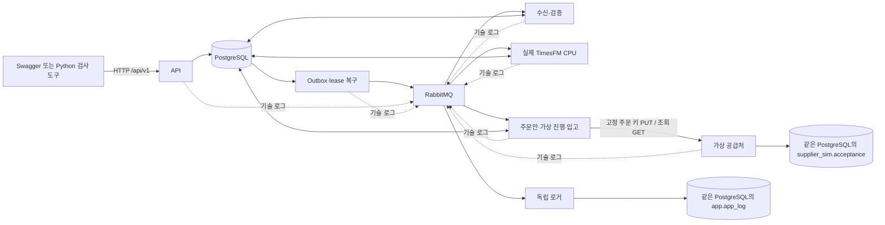
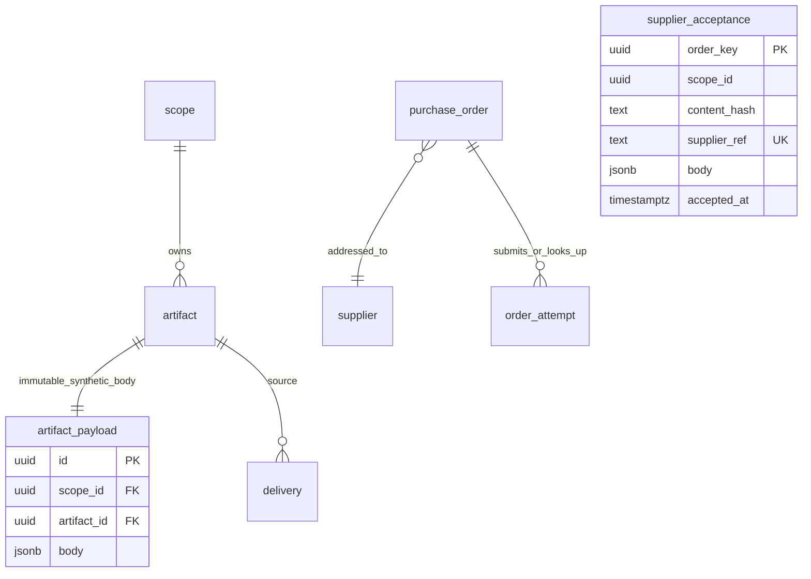

# 8단계 가상 물류 시스템 구현과 실행 검증

구현 버전 0.3 · 2026-10-21 · Linux ARM64 CPU 가상 평가

가상 자료 수신부터 실제 TimesFM 예측, 주문안, 명시적 승인, 가상 공급처 접수와 입고까지 실행하는 Compose 시스템을 구현했습니다. 연구 원자료·기존 결과는 사용하거나 수정하지 않았습니다. [실행 안내](../deploy/README.md)와 [검증 산출물](../runs/cheonan/operations_20261021_01/)을 함께 참조합니다.

## 1. 실행 구조

외부 연결은 API의 loopback 포트 8088입니다. DB·브로커·관리 화면·공급처 포트는 호스트에 공개하지 않습니다. API·수신·ML·업무·전달자·로거·공급처는 별도 DB 계정이며 migration 계정으로 실행하지 않습니다. ML·전달자·로거는 읽을 테이블도 제한합니다. 기존 범위 RLS와 복합 외래키를 그대로 적용합니다.

`src/operations/`는 연구 방법론 코드와 구분한 가상 시스템 구현입니다. 실제 추론은 기존 `src/methods/timesfm/adapter.py`의 native mask 경로를 재사용합니다.

| 파일 | 책임 |
|---|---|
| `api.py`, `contracts.py` | 기존 OpenAPI 요청·응답 검사, JWT·membership·멱등성, 실제 35개 API 동작 |
| `db.py` | scope 트랜잭션, 승인·입고와 Outbox, 영속 업무 이력 |
| `synthetic.py` | 초기 112일 이력, 20·10 또는 3·2품목, 일별 가상 소비·부족·주간 자료 |
| `ingestion.py` | 완전성·단위·가용시각 검사, 재고 anchor, 동결 입력·정정 영향 |
| `inference.py`, `ml.py` | 체크포인트 해시, Linux 실모델 preflight, 112·56일 입력과 14일 결과 저장 |
| `business.py` | 보호기간·포장 계산, Yes/No, 접수·조회, 부분 입고·전체 역분개·안전한 주문 해제 |
| `evaluation.py` | 가용 실제값의 첫째·둘째 주 평가와 revision별 근거 보존 |
| `worker.py`, `ml_fence.py` | 독립 실행 프로세스·heartbeat·lease·fencing·4회 시도·중복 처리 |
| `messaging.py` | 중앙 큐 선언과 유한 생산자 로그 버퍼 |
| `supplier.py` | 내부 주문 상태와 별개인 가상 공급처 접수 원장 |

## 2. 명세 대비 구현 선택

1. 최초 버전은 PostgreSQL 초기 SQL을 버전 관리하고 빈 볼륨에 순서대로 적용합니다. 기존 볼륨 자동 변경 기능은 넣지 않았습니다. 변경 배포에는 명시적 migration이 필요합니다.
2. 합성 JSON 원문은 외부 파일 대신 같은 DB의 불변 `artifact_payload.body`에 저장합니다. 원문 참조·해시·접수·작업·Outbox를 한 트랜잭션으로 확정할 수 있습니다. 앱에는 원문 변경 권한을 주지 않았습니다. 모델은 별도 읽기 전용 디렉터리입니다.
3. scope 행의 갱신 잠금 대신 모든 업무 변경이 동일한 PostgreSQL transaction advisory lock을 사용합니다. 모델·공급처 I/O 동안에는 잠금을 보유하지 않습니다. heartbeat는 별도 짧은 연결로 갱신합니다.
4. Pika의 수동 ack·publisher confirm과 독립 자식 프로세스를 사용합니다. 모델 작업 제한 초과 시 실제 프로세스를 종료하고, 오래된 token의 DB 확정을 거부합니다.
5. 기술 로그는 1,000건·5 MiB 버퍼, 16 KiB 본문, 최대 60초 재시도와 별도 발행 스레드를 사용합니다. 로그 소비는 200건·1초 배치와 커밋 후 ack입니다. 30일 만료 자료는 60초마다 scope별 최대 200건 정리합니다. 1 GiB를 넘으면 소비를 멈추고 30초마다 공간을 재확인합니다. 운영체제 파일 반환이나 무손실을 보장하지 않습니다.
6. 2020–2024년 달력은 기존 연구의 발표·가용시각 계약을 JSON으로 보존했습니다. 범위를 벗어나면 임의 공휴일 0을 넣지 않고 차단합니다. 가상 환자 수는 실제 개인 행 없이 독립된 범주별 합계로 생성합니다.

기본 명세의 46개 `app` 테이블에 다음 2개 저장 테이블을 추가했습니다. 총 48개이며 원본 [구조 SQL](06_contracts/schema.sql)과 [구현 추가 SQL](../deploy/init.sql)을 함께 적용합니다.

`supplier_acceptance`는 `supplier_sim.acceptance`입니다. 내부 주문 테이블을 외래키로 참조하지 않으며 공급처 자체 영속 주문 키로 조회합니다. `artifact_payload`에는 scope RLS와 복합 FK가 적용됩니다. 로그는 `app.app_log`에만 저장합니다.

## 3. Linux 실제 모델 확인

- Linux `aarch64`, Python 3.12, PyTorch 2.14.1, NumPy 2.5.3, CPU 실행입니다.
- 체크포인트 revision `43046b85ec22d584a13f8098c2ed39c889e129c2`의 config·weights SHA-256을 검사했습니다.
- 네트워크를 차단한 컨테이너에서 3채널·112일과 3채널·56일 입력을 각각 실행했습니다. 출력은 `[1,3,14,9]`, 모두 유한값입니다.
- 마지막 28일보다 이전 환자 입력을 변경해도 예측이 유지되었습니다. 높은 수준 API의 임의 보간을 사용하지 않았습니다.
- 사전 검사 전체 약 9.14초, 해당 프로세스 최대 RSS 약 3.26 GB입니다. 전체 서비스 메모리나 다른 장치의 보장값이 아닙니다.
- 이후 20개 약품과 10개 물품을 별도로 실제 추론해 주당 420개 날짜별 결과를 저장했습니다. 실패 시 기존·naive 결과로 대체하지 않습니다.

[사전 검사 JSON](../runs/cheonan/operations_20261021_01/linux_preflight.json)에 장치·버전·해시·형상·시간·메모리를 보존했습니다. 런타임의 PyTorch 배포판에 CUDA 의존성이 포함되어 있지만 이번 실행 장치는 CPU입니다.

## 4. 검증 기록

검사 도구는 새 scope를 생성하며 실제 서비스·PostgreSQL·RabbitMQ·TimesFM을 사용합니다. 최초 구현 중 발견한 권한 누락, 승인 응답 상태 코드, 정정 자료의 현재 revision 교체 순서를 수정했습니다. 실패 산출물도 실행 디렉터리에 보존합니다.

| 검사 | 근거 |
|---|---|
| 빈 DB 설치·권한 | [fresh_initialization.json](../runs/cheonan/operations_20261021_01/fresh_initialization.json) |
| 6주·30품목 실제 예측, 동시 승인, 부분·전체·중복·초과 입고, No, scope 격리 | [최신 연속 검사](../runs/cheonan/operations_20261021_01/system_scenario_release.json) |
| 브로커 중단·Outbox, 공급처 응답 유실·동일 키 조회, 로거 중단, 입고 역분개, 중복 명령, 최신 주간 정정, 봉인 보호, ML 강제 종료·새 token 복구 | [장애 검사](../runs/cheonan/operations_20261021_01/fault_scenario_release.json) |
| 실제 백업 복원·영속 키 보존·기존 공급처 조회 | [복원 검사](../runs/cheonan/operations_20261021_01/restore_scenario.json) |
| 서명 cursor·필터·권한, 정책 버전·재계산·0 주문, 전송 전 정책 변경 차단과 미전송 주문 해제 | [API 회귀 검사](../runs/cheonan/operations_20261021_01/api_checks.json) |
| 내보낸 이미지·모델을 별도 DB·브로커로 다시 가져와 1주·30품목과 No·입고 실행 | [패키지 재실행 검사](../runs/cheonan/operations_20261021_01/bundle_system_scenario.json) |

연속 시험에서 주간 version은 한 번만 증가하고, 품목별 요청=충족+부족이 성립합니다. 재고 anchor 이후 입고만 재고를 늘리고, 이미 포함된 과거 사건을 재생해 이중 합산하지 않습니다. 실제값 평가는 7개 관측이 모인 구간만 `ready`로 표시하고 미관측을 0으로 채우지 않습니다.

## 5. 패키지와 남은 검증 경계

서버 이전 도구는 이미지·체크포인트·코드·라이선스·파일 해시를 묶고 비밀값·현재 DB·병원 원자료는 제외합니다. 가져오기 시 CPU 구조·해시를 검사한 뒤 새 자격정보를 생성합니다. [실행 안내](../deploy/README.md)의 서버 이전 절차를 사용합니다.

현재 검증은 한 대의 Linux ARM64 가상 환경입니다. 묶음을 재실행하는 검사까지 수행했지만 AMD64·CUDA, 다른 서버로의 실제 네트워크 이전, 장기간 처리량·RPO/RTO 달성, 1 GiB 로그 포화, 전체 정책 조합을 완료했다고 주장하지 않습니다. 정정·복구의 전체 조합과 과거 정정 중 추론 경쟁은 추가 회귀 검사 대상으로 남깁니다. 이 8단계 기록의 범위에는 UI·실제 공급처 연결·실제 병원 재고 성과가 포함되지 않습니다. 이후 실제 API를 연결한 UI와 브라우저 검사 결과는 [10단계 구현 기록](10_FRONTEND_IMPLEMENTATION.md)을 따릅니다.
