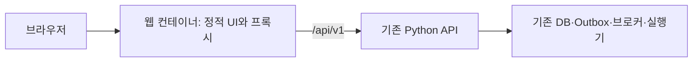

> 초기 화면 계획의 과거 기록입니다. 확정 UI와 실행 구조는 [12단계 대시보드](12_DASHBOARD_IMPLEMENTATION.md)를 따릅니다. 이전 화면은 삭제되었습니다.

# 9단계 프론트엔드 화면 설계와 구현 계획

계획 버전 0.4 · 2026-10-22 · MTeCH 브랜드 화면 시안과 구현 계획 · 실제 API 연결 전

주간 업무 화면을 중심으로 **가상 자료 전달 → 예측·재고 확인 → 주문안 검토·Yes/No → 공급처 접수 확인 → 입고·재고 반영**을 연결합니다. 사용자는 현재 업무 단계와 다음 행동을 같은 위치에서 확인합니다. 반복 시험에 필요한 예측·주문·입고 이력은 별도 목록에서 다시 엽니다.

[설계 진입점](README.md) · [현재 API와 실행 구현](08_IMPLEMENTATION.md) · [OpenAPI](06_contracts/openapi.json)

## 1. 화면 구성과 디자인 방향

기본 시안은 **업무표 중심**입니다. 홈과 왼쪽 메뉴 없이 자료 전달부터 주문·입고까지 한 업무 화면으로 통합합니다. 공통 상단에는 로고 하나와 가상 시각을 두고, 콘텐츠 최상단에는 자료 전달·예측·재고·주문 승인·접수 확인·입고 단계 탭을 둡니다. 별도의 큰 단계 제목은 반복하지 않습니다. 탭 아래에는 기간, 품목표와 선택 품목의 예측을 놓고, 오른쪽에는 현재 검토할 주문안과 승인 행동을 둡니다. 화면이 좁아지면 오른쪽 영역을 표 아래로 옮깁니다.

비교 시안은 **단계 안내 중심**입니다. 한 번에 한 단계의 작업을 넓게 보여주고 다음 행동으로 이동합니다. 최초 체험에는 단순하지만 여러 품목·주문을 대조하는 반복 업무에는 이동이 많으므로 기본 구현은 업무표 중심으로 제안합니다. 두 시안은 같은 API와 업무 규칙을 사용합니다.

| 영역 | 화면에 표시할 내용 | 주요 조작 |
|---|---|---|
| 공통 상단 | 로고 한 개, 가상 업무 시각 | 별도 홈 이동 없음 |
| 통합 업무 탭 | 자료 전달 → 예측·재고 → 주문 승인 → 접수 확인 → 입고 | 단계 전환 |
| 주간 업무 | 자료 수신·검사·예측·주문안 준비 상태, 현재 처리 단계 | 다음 주 가상 자료 전달, 예측·재고 보기 |
| 예측·재고 | 품목 이름·단위·가용 재고·입고 예정·보호기간 수요·권고 포장, 선택 품목 14일 예측 | 품목 선택, 약품/물품 구분, 상세 근거 |
| 주문안 검토 | 전체 주문안 버전, 공급처별 양의 권고 라인, 포장·수량, 차단 사유, 승인 만료 시각 | 주문 승인, 주문하지 않음, 최신 상태로 재계산 |
| 주문과 입고 | 전송 대기·접수 확인 중·접수 완료, 주문량·입고량·잔량·예정 시각 | 접수 여부 조회, 부분·전체 입고, 입고 취소 |
| 이력과 처리 내역 | 주차별 제출·예측·주문안·결정·주문·입고 연결, 이전/정정 구분 | 주차 다시 열기, 실패 원인·허용된 재시도 |

제공된 **MTeCH 회사 로고를 공통 상단에 한 번만** 배치합니다. 별도 홈과 홈 이동 버튼은 만들지 않습니다. 원본의 글자·형태·빨강/파랑 구획을 재작성하거나 변형하지 않고, 표시할 때 비율을 유지합니다. 화면에서 `가상 평가`, `디자인 시안·예시 자료·API 미연결`, `MTeCH WORKSPACE`, 평가 시나리오와 기본 품목 구성 설명을 제거합니다. 기본 시나리오·주간 업무 머리말과 큰 단계 제목도 제거합니다. 가상 시각은 유지하며, 시나리오 설정은 업무 화면의 상시 안내에서 제외합니다.

테마는 로고의 로열 블루·빨강·흰색을 기준으로 합니다. 주 행동과 선택 상태·예측 그래프는 파랑, 화면 배경은 흰색과 옅은 청색, 본문은 짙은 남색을 사용합니다. 빨강은 상단 브랜드 포인트와 실제 오류·차단에 제한합니다. 브랜드 장식의 빨강에는 상태 의미를 부여하지 않으며, 오류에는 문구·아이콘을 함께 둡니다. 완료·주의 상태의 초록·주황은 별도로 유지합니다. 어두운 화면은 남색 바탕과 밝은 파랑으로 같은 정보 위계를 유지합니다.

| 디자인 항목 | 기본 색상/규칙 |
|---|---|
| 주 행동·선택·예측 선 | 로열 블루 `#2454E8` |
| 브랜드 빨강 | `#EC2435`, 제한된 포인트 |
| 기본 배경·보조 배경 | 흰색 `#FFFFFF` / 옅은 청색 `#F3F6FD` |
| 본문·구분선 | 남색 `#18264A` / `#DAE2F2` |
| 로고 배치 | 공통 상단에 한 개, 대체 텍스트 제공 |

표는 얇은 구분선과 수량 오른쪽 정렬을 사용하고, 숫자는 같은 폭으로 정렬합니다. UUID·해시·작업 시도 번호는 접을 수 있는 처리 내역에 둡니다. 제공 원본은 [회사 로고](assets/company_logo.png)에 그대로 보존하며 실제 프론트엔드 구현 시 정적 브랜드 자산으로 포함합니다.

큰 숫자 요약에는 품목 수·검토할 주문안 수·접수 확인이 필요한 주문 수처럼 합산 가능한 개수만 씁니다. 서로 다른 단위의 약품·물품 수량을 하나의 총수량으로 더하지 않습니다. 전체 확률 정확도나 신뢰도 점수를 임의로 만들지 않습니다.

## 2. 첫 방문과 시나리오

1. 로컬 평가 접속 화면에서 발급된 토큰을 입력합니다. JWT 서명 비밀값과 DB 접속정보는 프론트엔드에 전달하지 않습니다.
2. 시나리오가 없으면 이름·첫 월요일·시드·30품목/빠른 5품목·초기 112일 이력을 지정해 생성합니다. 기본 날짜는 지원되는 달력 범위의 `2024-03-04`를 사용합니다.
3. 초기 준비 중에는 해당 단계를 표시합니다. 준비가 끝나야 가상 주간 전달 버튼을 활성화합니다.
4. 시나리오를 URL에 포함하여 새로고침해도 같은 업무를 엽니다. 최근 시나리오 ID·선택 품목 같은 비밀이 아닌 화면 상태만 브라우저에 저장합니다.

토큰은 초기 로컬 평가에서 메모리에만 유지합니다. 새로고침 시 다시 입력하도록 하고 만료 시 재입력을 안내합니다. 실제 서비스 로그인·SSO는 별도 범위입니다. 브라우저에서 JWT를 풀어 본 결과만으로 권한을 확정하지 않습니다.

## 3. 단계별 업무와 API

아래 경로는 `/api/v1` 기준입니다. 현재 존재하는 API와 제안하는 추가 API를 구분합니다.

| 단계 | 표시와 행동 | 현재 API |
|---|---|---|
| 시나리오 준비 | 생성·초기 준비·가상 시각 | `POST /test/scenarios`, `GET /test/scenarios/{id}` |
| 가상 자료 전달 | 현재 `next_week_start`와 `version`으로 마감한 한 주 생성 | `POST /test/scenarios/{id}/weekly-deliveries` |
| 자료 검증 | 제출 기간·revision·반려 사유 | `GET /weekly-deliveries`, `GET /weekly-deliveries/{id}`, `GET /weekly-deliveries/{id}/issues` |
| 처리 상태 | 주간 수신·예측·주문안 작업을 구분 | `GET /jobs`, `GET /jobs/{id}` |
| 예측과 재고 | 품목별 14일 값, 가용 재고, 확정/예약 입고 | `GET /items`, `GET /inventory`, `GET /forecasts`, `GET /forecasts/{id}/values` |
| 주문안 확인 | 보호기간·안전재고·기존 주문·권고량·차단 근거 | `GET /order-proposals`, `GET /order-proposals/{id}` |
| 승인·거절 | 동일 버전·내용 전체에 대해 Yes/No | `POST /order-proposals/{id}/decisions` |
| 재계산 | 상태 변경 시 새 버전으로 다시 검토 | `POST /order-proposals/{id}/recalculate` |
| 공급처 확인 | 승인과 접수를 구분, 결과 불명 조회 | `GET /purchase-orders`, `GET /purchase-orders/{id}`, `POST /purchase-orders/{id}/reconcile` |
| 입고 | 접수 완료 주문의 부분/전체 입고 작업 | `POST /purchase-orders/{id}/receipts`, `GET /receipts/{id}` |
| 입고 취소·주문 해제 | 원기록을 보존한 전체 입고 취소, 안전한 미전송 주문 종료 | `POST /receipts/{id}/reversals`, `POST /purchase-orders/{id}/release` |
| 평가·진단 | 첫째/둘째 주 실제값 평가, 충족·부족, 권한 있는 기술 로그 | `GET /forecasts/{id}/evaluations`, `GET /test/scenarios/{id}/demand-outcomes`, `GET /logs` |

일반 JSON 자료 제출은 다음 확장으로 `POST /weekly-deliveries`에 연결합니다. 첫 버전의 주 행동은 가상 자료 전달이며, 실제 환자 개인 자료 업로드 화면은 만들지 않습니다.

## 4. 예측·재고 화면의 해석

- 품목을 선택하면 해당 품목의 **다음 14일 일별 중앙값 예측**을 표시합니다. 첫 화면의 모든 값에 품목 이름·단위·예측 원점을 연결합니다.
- 권고 표의 수요는 주문 정책의 **보호기간 수요**입니다. 14일 예측 합계와 기간이 다를 수 있으므로 다른 이름과 기간을 표시합니다.
- 가용 재고, 확정된 입고 예정, 승인 후 접수 대기 예약을 나눕니다. 같은 주문을 두 번 더하지 않습니다.
- 필요한 수량·포장 반올림·최소 발주량·차단 결과는 서버 주문안을 사용합니다. 브라우저에서 발주 정책을 다시 계산하지 않습니다.
- 과거 실사용 그래프를 현재 API의 예측 평가 수치에서 역으로 만들지 않습니다. 현 API에는 일별 사용량 조회가 없으므로 초기 화면은 미래 예측만 표시합니다.
- 9개 분위수에 임의로 95% 신뢰구간이라는 이름을 붙이지 않습니다. 초기 화면은 중앙값만 사용하고 분위수 수준이 API 계약에 명시된 뒤 범위를 확장합니다.
- 예측 실패·입력 정정으로 무효가 된 결과는 이전 성공값으로 조용히 대체하지 않습니다. 마지막 성공 결과를 열 수는 있지만 현재 주문안의 근거와 구분합니다.

## 5. 승인과 입고 조작

승인 창에는 예측 원점, 보호기간, 주문안 버전, 공급처별 양의 주문 라인, 포장과 기본 단위, 만료 시각을 보여줍니다. 두 버튼은 `주문 승인`과 `주문하지 않음`으로 표시합니다. 현재 API는 전체 주문안의 승인·거절만 지원하므로 품목 선택 체크박스·수량 직접 편집·선택 품목만 승인 기능을 넣지 않습니다. 표의 행 선택은 그래프를 볼 품목 선택만 뜻합니다.

주문안이 차단되면 승인 버튼을 비활성화하고 사유를 바로 옆에 둡니다. 재고·정책·입력 revision이 바뀌어 409가 반환되면 승인 창을 닫고 최신 상태와 새 주문안을 다시 확인하게 합니다. 자동으로 새 버전을 승인하지 않습니다. 권고가 전부 0이면 `추가 주문 없음`으로 표시하고 공급처 주문을 만들지 않은 서버 결과를 그대로 보여줍니다.

승인이 저장되면 `주문 전송 대기`를 표시합니다. 공급처 접수를 확인해야 `접수 완료`가 되고, 입고 작업이 확정되어야 재고 증가를 표시합니다. 결과 불명 상태의 주 행동은 `접수 여부 확인`이며 새 주문 버튼을 제공하지 않습니다.

입고 창에는 품목별 주문량·누적 입고량·남은 수량과 입력 수량을 함께 놓습니다. 기본 조작은 `잔량 전부 채우기`와 `입고 기록`입니다. 부분 수량은 문자열 십진수로 검증하고, 단위는 읽기 전용으로 둡니다. 출처 사건 키는 조작 시작 시 한 번 생성합니다. 가상 입고 시각의 기본값은 PC의 현재 시간이 아닌 **시나리오의 가상 시각**이며 접수 시각 이후·가상 시각 이하로 제한합니다. 다음 주 진행에서 예정 입고가 자동 반영되면 수동 입고 화면도 갱신합니다.

잘못 기록한 입고는 원기록에서 `전체 입고 취소`로 역분개합니다. 이미 재고 기준 시점에 포함된 입고 등 서버가 차단하는 경우를 화면에서 우회하지 않습니다. 입고 이력에는 원기록과 취소 기록을 연결합니다.

## 6. 비동기 상태와 오류 처리

| 상태 | 화면 처리 |
|---|---|
| HTTP 202 | `요청 접수`와 조회할 작업 참조를 보존합니다. 업무 완료로 표시하지 않습니다. |
| 작업 진행 | `자료 검사 중 → 예측 중 → 주문안 계산 중`으로 표시합니다. 실제 근거 없는 백분율은 표시하지 않습니다. |
| 단계 작업 성공 | 자식 작업·실제 결과 상태를 확인합니다. 최상위 한 작업 성공만으로 전체 완료를 판단하지 않습니다. |
| 통신 중단 | 마지막 조회 시각과 연결 중단을 표시합니다. 처리 실패나 주문 거절로 바꾸지 않습니다. |
| 409 | 최신 상태 조회·검토로 되돌립니다. 새 Idempotency-Key를 만들어 자동 재승인하지 않습니다. |
| 401 / 403 / 404 | 토큰 재입력 / 권한 없음 / 접근 가능한 자료 없음으로 구분합니다. |
| 자료 검증 반려 | 제출 기간과 필드·업무 오류를 표시합니다. 예측 완료 화면을 열지 않습니다. |
| 결과 불명 주문 | 접수 조회만 안내하고 재전송·예약 해제는 서버 허용 상태를 따릅니다. |

활성 작업과 미확정 주문은 1~2초 간격으로 조회하고, 장시간 변화가 없으면 간격을 늘립니다. 완료 시 폴링을 멈추고 비활성 탭에서는 빈도를 낮춥니다. 폴링 대기시간이 지났다는 이유로 새 업무 요청을 만들지 않습니다. 새로고침 시 서버 상태를 다시 조회합니다.

모든 변경 요청은 한 사용자 조작에 하나의 Idempotency-Key를 부여합니다. 전송 결과가 불명확할 때에는 같은 본문·같은 키로 복구하며, 명시적으로 새 조작을 시작할 때만 새 키를 만듭니다. 첫 버전의 가상 진행·승인·입고 요청은 주체·시나리오·경로·동결 본문·키·본문 해시·작업 참조를 세션 단위로 보존하고, 불명 상태에서는 입력을 바꿔 다시 보내지 못하게 합니다. 토큰은 저장하지 않으며 재접속한 주체가 바뀌면 이전 주체의 요청을 재전송하지 않습니다. 향후 실제 자료 업로드 본문에는 이 보존 방식을 그대로 적용하지 않습니다. UI의 버튼 잠금과 서버의 멱등성을 함께 사용합니다.

캐시 키에는 시나리오·예측 원점·revision·필터를 포함합니다. 시나리오를 바꾸면 이전 조회를 취소하고 이전 시나리오 데이터를 숨깁니다. 이전 요청이 늦게 끝나도 현재 화면을 덮어쓰지 못하게 합니다. 주간 작업의 자식 작업과 `delivery_id → snapshot_id → forecast_id → proposal_id`를 추적하여 현재 결과를 고릅니다. 같은 원점의 정정 결과가 있을 수 있으므로 날짜만 가장 최근인 결과를 선택하지 않습니다. 기술 로그 없이도 작업·주문·입고 상태를 조회할 수 있어야 합니다.

## 7. 프론트엔드 연결용 조회 API

2026-10-22 두 조회 API를 구현했습니다. `/me`는 검증된 주체와 선택 범위의 실시간 역할을 반환합니다. 시나리오 목록은 본인이 생성한 범위에 한정하며 현재 membership을 다시 검사합니다. 공유받은 범위는 업무 ID로 엽니다.

| 구현 API | 필요성 | 계약 |
|---|---|---|
| `GET /me` | 토큰에서 추정하지 않고 실제 역할·접근 범위 확인 | 검증된 주체·플랫폼 역할·해당 membership, 비밀값 제외 |
| `GET /test/scenarios` | 새 브라우저에서도 접근 가능한 시나리오 선택 | 본인 생성·현재 membership으로 제한한 목록·진행 상태·서명 cursor, 플랫폼 test_admin 권한 |

추가로 과거 실사용 곡선이 필요할 때 `GET /items/{id}/usage-days`를 설계합니다. 최신 검증 revision, 관측/미관측, 단위·가용시각·조회 종료일 포함 여부를 명시해야 합니다. 자료 수신 화면의 실제 행 수·공란 수는 향후 제출 요약 조회로 제공합니다. 현재의 기대 조합 수를 실제 수신 행 수처럼 표시하지 않습니다.

토큰 발급 로그인 API·웹소켓·프론트엔드 전용 DB·프론트엔드의 메시지 큐 직접 연결은 첫 버전에 필요하지 않습니다.

## 8. 프론트엔드 구현 구성

브라우저 UI는 React·TypeScript, 정적 빌드는 Vite, 서버 상태 조회·동기화는 TanStack Query를 제안합니다. Python API와 현재 업무 실행기는 유지합니다. 외부 검색 노출이 필요한 서비스가 아니고 이미 Python API가 있으므로 정적 SPA를 단일 웹 컨테이너에서 제공하는 구성을 선택합니다. 이 선택은 React의 모든 앱에 대한 기본 권고라는 뜻이 아닙니다. [React 앱 구성](https://react.dev/learn/creating-a-react-app), [Vite의 정적 빌드](https://vite.dev/guide/), [TanStack Query 서버 상태 관리](https://tanstack.com/query/latest/docs/framework/react/overview).

실제 구현 시 `frontend/`를 만들고 OpenAPI에서 타입을 생성합니다. 주요 경계는 `api`(인증·멱등성·오류), `features/scenarios`, `weekly`, `forecast`, `proposals`, `orders`, `receipts`, 공통 표·상태·확인 창입니다. 의존성 버전은 구현 시 고정하며 계획 단계에서 빈 컴포넌트를 미리 만들지 않습니다.

웹 컨테이너가 정적 화면과 `/api/` 역방향 프록시를 같은 주소로 제공합니다. Compose에는 웹 서비스 하나를 추가합니다. 브라우저는 API만 호출하고 DB·RabbitMQ에는 접근하지 않습니다. 토큰·입고 원문·개인정보를 URL·콘솔·분석 도구에 남기지 않습니다. 원시 외부 오류 문자열은 HTML로 삽입하지 않습니다.

## 9. 구현 순서와 완료 기준

| 단계 | 구현 | 완료 기준 |
|---|---|---|
| 1. 접속 기반 | 필요한 두 조회 API, OpenAPI 타입, 토큰 입력, 시나리오 선택·생성, 웹 컨테이너 | 새 브라우저에서도 권한에 맞는 시나리오를 다시 열기 |
| 2. 한 주 전달 | 다음 주 버튼, 단계 표시, 작업·자식 작업 조회, 제출 오류 | 한 번의 클릭으로 한 주만 진행, 새로고침 후 같은 작업 추적 |
| 3. 예측·재고 | 전체 페이지 조회·품목별 그래프·보호기간 근거·재고 구분 | 30품목/420개 예측값이 누락 없이 조회되고 단위·기간이 구분됨 |
| 4. 승인·접수 | 전체 주문안 확인 창, Yes/No, 재계산, 주문 상태와 불명 조회 | 이중 클릭 한 번 승인, No 주문 없음, stale 승인 거부, 불명 재발주 없음 |
| 5. 입고·이력 | 부분·전체 입고, 취소, 재고 갱신, 주간·주문 상세 이력 | 입고량·잔량·재고가 일치하고 중복 입고 효과 없음 |
| 6. 브라우저 수용 검사 | 실제 Linux TimesFM으로 30품목·6주, 중단·새로고침·역할·좁은 화면·패키지 재실행 | UI부터 DB까지 전체 흐름과 장애 회복을 재현 |

컴포넌트 검사는 승인 상태 전이·정확 수량·중복 조작·시나리오 전환 같은 오류 가능성이 있는 경계에 집중합니다. 실제 브라우저 검사는 접근 가능한 이름과 상태 텍스트를 사용하고, 기다리는 조건은 임의 시간 지연보다 작업·업무 상태를 기준으로 합니다. 작은 화면·키보드·명암 두 테마에서 버튼과 표·오류가 가리지 않는지도 검사합니다.

이 문서는 화면 설계와 계획입니다. 실제 API 연결·웹 컨테이너·브라우저 검증 결과와 남은 범위는 [10단계 구현 기록](10_FRONTEND_IMPLEMENTATION.md)에 구분합니다. 현재 UI는 승인·접수·부분/전체 입고의 주 흐름을 구현했으며 입고 취소·정책 편집·6주 UI 연속 검사는 후속 범위입니다.
