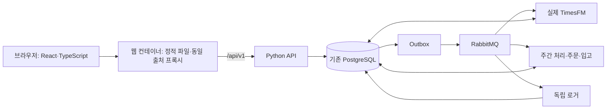

> 이전 UI의 검증 이력입니다. 해당 실행 화면·스타일은 삭제되었으며 현재 UI는 [12단계 대시보드](12_DASHBOARD_IMPLEMENTATION.md)를 따릅니다.

# 10단계 프론트엔드 실제 연결과 검증

구현 버전 0.1 · 2026-10-22 · Linux ARM64 Compose와 실제 TimesFM 연결

확정한 MTeCH 디자인으로 **자료 전달 → 예측·재고 → 주문 승인 → 접수 확인 → 입고**를 구현했습니다. 홈·왼쪽 메뉴 없이 상단 로고 하나와 가상 시각, 다섯 단계 탭을 사용합니다. 브랜드 파랑·빨강 줄을 유지하고 평가 표시·시안 문구·기본 품목 구성 안내·큰 단계 제목을 반복하지 않습니다.

실행 주소는 <http://127.0.0.1:8090/>입니다. 접속 화면에서 발급된 토큰 파일을 선택한 뒤 업무를 준비합니다. 실행·재발급·개발 명령은 [배포 안내](../deploy/README.md)를 따릅니다. 이 문서의 검증은 합성 자료와 가상 공급처에 한정하며 연구 원자료를 사용하지 않았습니다.

## 1. 구현 구성

| 경로 | 책임 |
|---|---|
| `frontend/src/App.tsx` | 토큰 접속, 업무 선택·생성, 통합 단계, 서버 권한, 승인 확인, 작업 조회·복구 |
| `frontend/src/Panels.tsx` | 품목별 14일 그래프·재고표·권고표, 정확한 입고 입력 |
| `frontend/src/api.ts` | 동일 출처 API, 전체 cursor 페이지 조회, 중단 신호, 변경 요청 영속 키·응답 유실 복구 |
| `frontend/src/domain.ts` | 동결 입력 revision과 결과 연결, 소수 문자열·날짜·상태 표시 |
| `frontend/src/schema.d.ts` | 현재 OpenAPI에서 생성하는 타입 |
| 이전 스타일(퇴역)·`frontend/public/company_logo.png` | 확정한 디자인과 제공 원본 로고 |
| `deploy/Dockerfile.web`, `deploy/web.conf` | 고정 이미지·의존성으로 빌드, 비특권 읽기 전용 Nginx, API 프록시 |

React·Vite·TanStack Query·Decimal.js와 개발 의존성은 package-lock에 고정합니다. 브라우저 조회는 TanStack Query의 취소 신호를 전달하고 키에 주체·업무·예측 ID를 포함합니다. 구성 근거는 [Vite 공식 안내](https://vite.dev/guide/), [조회 취소](https://tanstack.com/query/latest/docs/framework/react/guides/query-cancellation), [OpenAPI 타입 생성](https://openapi-ts.dev/introduction)입니다.

Compose에 웹 서비스 하나를 추가했습니다. 웹과 API는 loopback 8090·8088로 열며 DB·브로커·공급처는 내부 네트워크에 유지합니다. 웹은 토큰을 내장하지 않습니다. 로그·환자 원문을 브라우저 콘솔에 기록하지 않으며 UI는 API를 통해서만 업무를 수행합니다. 웹의 HTTP access log는 비활성화하고 기존 API·실행기의 업무 로그는 중앙 브로커와 독립 로거를 따릅니다. 웹 컨테이너 자체 오류는 인프라 stderr입니다.

## 2. 실제 API와 업무 연결

- `GET /me`로 실제 주체와 선택 범위의 membership을 확인합니다. JWT를 브라우저에서 해석한 권한을 사용하지 않습니다.
- `GET /test/scenarios`로 본인이 생성하고 여전히 접근 가능한 업무를 다시 엽니다. 공유받은 범위는 ID로 열 수 있습니다. 두 조회의 계약은 [API 명세](06_contracts/API_SPEC.md)를 따릅니다. DB 테이블·권한을 새로 추가하지 않았습니다.
- 초기 준비 후 현재 서버 `version`·`next_week_start`로 한 주를 전달합니다. 주간 생성 작업 하나의 성공을 전체 완료로 표시하지 않으며 시나리오가 `ready`가 되고 예측·주문안이 준비될 때까지 조회합니다.
- 완료 주간의 검증된 최신 revision과 snapshot에 연결된 현재 유효 예측만 선택합니다. 처리 중·실패한 새 주간에 이전 성공 예측을 현재 결과로 대체하지 않습니다.
- 전체 cursor 페이지를 읽어 실제 30품목·420개 예측값을 확인합니다. 선택 품목의 14일 날짜·개수가 완전해야 그래프를 표시합니다. 과거 사용량이나 임의 신뢰구간은 만들지 않습니다.
- 재고는 서버의 가용·확정 입고 예정·접수 대기 예약을 구분합니다. 권고는 서버의 보호기간·안전재고·포장 결과를 사용합니다. 브라우저에서 주문 정책을 계산하지 않습니다.
- 승인 창의 주문안 ID·버전·내용 해시를 동결합니다. Yes는 해당 전체 주문안을 승인하고 No는 주문하지 않음을 기록합니다. 409에서는 확인 창을 닫고 최신 상태를 다시 조회하며 자동 승인하지 않습니다.
- 승인·공급처 접수·입고를 구분합니다. 불명 주문에는 `접수 여부 확인`을 제공합니다. accepted 주문에만 입고를 입력하며 작업 성공 후 주문 잔량·재고를 다시 조회합니다.
- 입고 수량은 문자열로 받고 소수점 여섯 자리·정확한 잔량을 검사합니다. 금지된 지수 표기·음수·초과를 차단합니다. 사건 키는 조작 시 한 번 생성하며 입고 시각은 PC 시간이 아닌 서버 가상 시각을 사용합니다.

## 3. 응답 유실과 새로고침

토큰은 메모리에만 유지합니다. 새로고침하면 다시 접속하며 URL의 업무 ID·단계로 같은 화면을 엽니다. 업무 이름·업무 선택은 설정에서 관리하고 운영 화면에 별도 시나리오 요약을 반복하지 않습니다.

변경 전 세션 저장소에 검증된 주체 ID·범위·경로·동결 JSON 본문·Idempotency-Key를 저장합니다. 저장 실패 시 요청하지 않습니다. 입력은 합성 주간·승인·입고에 한정하고 인증 토큰은 저장하지 않습니다. 통신 오류·5xx에서는 요청 결과를 실패로 단정하거나 새 키로 다시 보내지 않습니다. 같은 주체가 다시 접속하면 `같은 요청으로 접수 확인`으로 동일 본문·동일 키를 재사용합니다. 다른 주체로 로그인하면 이전 주체의 요청을 재전송하지 않습니다.

202 응답은 작업 참조를 보존하고 완료까지 변경 조작을 잠급니다. 실패 코드를 표시하고 서버가 허용하는 실패 작업만 같은 작업에 재시도를 요청할 수 있습니다. 주간 작업·미확정 주문이 진행 중이면 2초 간격으로 조회하며 비활성 탭의 지속 조회는 중단합니다. 정상 완료 상태에서는 정기 조회를 멈추고 화면 재접속·명시적 조작·포커스 복귀 시 서버를 다시 확인합니다. 연결 오류 때는 마지막 조회 시각과 재확인 행동을 표시합니다.

이 보존은 현재 브라우저 탭의 세션 범위입니다. 탭 자체를 폐기한 경우 서버의 업무·주문 이력으로 확인해야 하며 브라우저 저장소를 영구 업무 원장으로 취급하지 않습니다.

## 4. 검증 근거

검사는 [실행 디렉터리](../runs/cheonan/frontend_20261022_01/)에 보존합니다. 최초 No 검사에서 복합 상태 문구를 정확 문자열로 찾던 브라우저 locator를 수정했으며 최종 결과는 아래 파일입니다. 승인 응답 유실 시 확인 창을 닫아 복구 행동을 사용할 수 있게 했습니다.

| 검사 | 결과와 근거 |
|---|---|
| 타입·배포 빌드·고정 의존성 | 로컬 TypeScript/Vite 빌드와 Linux 웹·API·ML 이미지 빌드 성공. `build-local-final.log`, `build-web-pinned.log` |
| 집중 단위 검사 | 정확 소수·잔량·잘못된 입력·날짜·snapshot/revision 선택·처리 중 과거 예측 차단, 2개 검사 통과 |
| 전체 화면 흐름 | 실제 Linux TimesFM 30품목·420개 예측 → Yes → 접수 → 초과 입고 거부 → 부분·전체 입고. 각 품목 재고 증가량=주문량 검증 |
| No와 재접속 | 주문 0건, 새로고침 후 토큰 재입력과 범위·단계 복원, 저장소에 JWT 없음 |
| 응답 유실 | 실제 승인은 서버에 커밋한 뒤 브라우저 응답을 끊음. 재접속·동일 키 조회 후 주문 정확히 1건 |
| 최종 브라우저 검사 | [JSON](../runs/cheonan/frontend_20261022_01/final/browser-results.json): 3 passed, 실패·flaky 0. 각 검사에서 새 합성 scope 사용 |
| 인증·범위·cursor | [JSON](../runs/cheonan/frontend_20261022_01/access_checks.json): 목록 주체 제한, principal 바인딩 서명 cursor, 다른 범위 404, membership 제거·disabled 주체 검사 통과 |
| 화면 확인 | 320px·1280px, 밝은/어두운 테마, 로고 한 개·가로 페이지 넘침 없음. 최종 viewport PNG는 `final/`에 보존 |

실제 실행은 Linux ARM64 CPU이며 기존 고정 체크포인트를 사용했습니다. 모델·서비스 이미지 ID, 코드·계약·의존성 파일 해시와 최종 검사 참조는 [manifest](../runs/cheonan/frontend_20261022_01/manifest.json)에 기록합니다. 연구 원자료·환자 개인 행을 화면이나 검사에 사용하지 않았습니다.

## 5. 배포와 남은 범위

서버 내보내기 도구에 프론트엔드 소스·잠금 파일·웹 이미지를 포함하고 node_modules·빌드 임시 결과·인증정보는 제외하도록 갱신했습니다. 현재 스택에서 웹 이미지를 새로 빌드하고 전체 컨테이너를 재기동하여 검증했습니다. 웹을 포함한 새 이전 묶음의 내보내기·별도 서버 재가져오기, AMD64·CUDA·실제 공급처·실제 병원 운영 성과는 이번 검증에 포함하지 않습니다.

입고 취소·주문 예약 해제 UI, 정책 편집, 더 상세한 주차별 이력 탐색, 실제 로그인·SSO, 6주 UI 연속 검사, 브라우저 종류별 검증은 후속 범위입니다. 해당 서버 API가 존재한다는 이유로 UI 구현까지 완료했다고 표시하지 않습니다. 현재 목적의 가상 자료 전달부터 승인·입고까지는 실제 API로 한 흐름을 실행할 수 있습니다.
