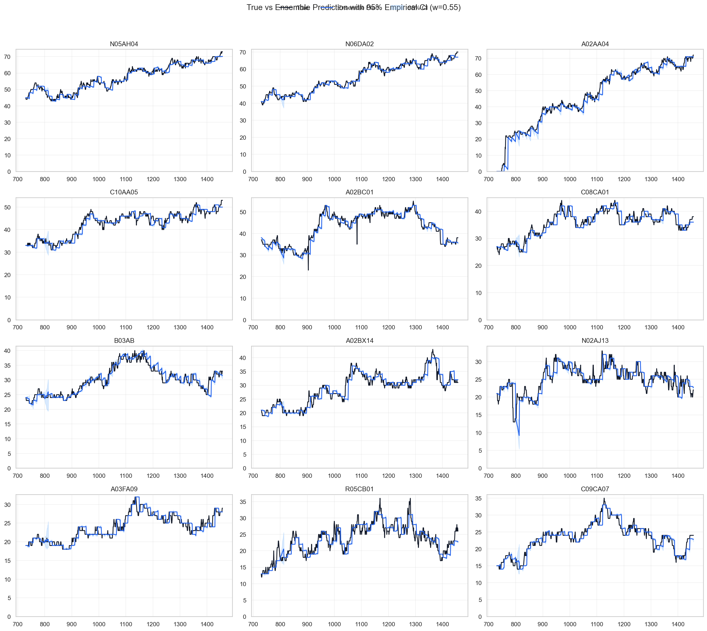
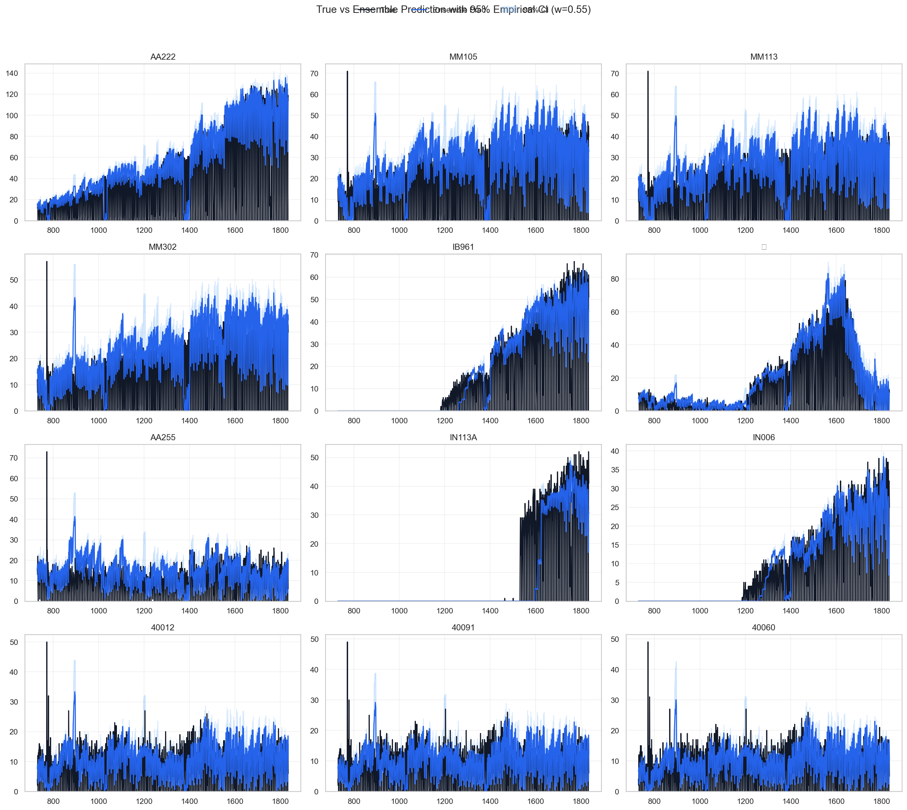

# Seed Ensemble 潜在ダイナミクスによる14日間医薬品需要予測：Seosong・Epurun 病院での Rolling 評価

**作業原稿 — 投稿規定適用前**

**著者・所属:** 研究責任者が記入する。

## 要旨

短期医薬品需要予測は病院在庫計画に利用できる可能性があるが、多数かつ疎な target と強い時系列持続性のため、厳密な評価が必要である。本研究では Seosong および Epurun の日次データを用い、二段階 latent autoencoder forecasting pipeline（LAVAR）を評価した。Stage 1 は患者側・暦共変量から共有潜在表現と潜在ダイナミクスを学習し、Stage 2 はそれを固定して需要密度別の医薬品予測 head を学習する。基本潜在モデルと1層 GRU supply head（`S04_GRU_H32_L1`）、および拡張 latent-16 モデル（`S11_LATENT16`）を5 random seed で比較し、`0.55 × S11 + 0.45 × S04` で結合した。

評価は expanding-history rolling origin、14日 horizon、14日 step を用いた。Seed ごとの fold 数は Epurun 52、Seosong 79 であった。Epurun の ensemble mean MSE は0.9195で、S11より4.38%低く、mean p95 fold MSE は1.3365から1.3070へ低下し、保存済み promotion rule を満たした。Seosong の ensemble MSE は1.8214でS11より3.17%低かったが、p95 fold MSE は4.4179から4.4676へ増え、promotion rule を満たさなかった。Last-value naive forecast に対する mean skill は両病院で負であった（−0.1092、−0.1340）。したがって ensemble は評価対象 learned model 間の平均誤差を低減したが、persistence baseline を全体として上回らなかった。Epurun では候補として検討できる一方、Seosong では追加検証または適応的選択が必要である。

**Keywords:** 医薬品需要; 病院予測; rolling-origin 評価; 潜在ダイナミクス; ensemble; seed stability

## 1. はじめに

病院の医薬品需要は高次元、間欠的、かつ不均一である。予測 model は患者活動の共有構造と医薬品別 pattern を同時に表現し、時間順序を保った評価と強い persistence baseline 比較を受ける必要がある。

本研究は、二つの LAVAR 設定と固定 ensemble の14日予測における seed stability、平均・tail 誤差、病院別の運用判断を検討する。対象は Seosong と Epurun のみである。

## 2. データと方法

### 2.1 データ

| 病院 | 期間 | 日次観測 | 共変量 | 医薬品 target | Seed ごとの fold |
|---|---|---:|---:|---:|---:|
| Epurun | 2021-01-01–2024-12-31 | 1,461 | 45 | 248 | 52 |
| Seosong | 2020-12-14–2025-12-31 | 1,844 | 38 | 3,126 | 79 |

Epurun は処理済み患者側変数38個と暦変数7個を使用した。Seosong は患者側変数38個を使用した。Target 数と需要 scale が大きく異なるため、raw MSE を病院間 ranking として解釈しない。

Repository には機微な病院データが含まれる可能性がある。公開・共有には承認済み governance、de-identification、倫理文言が必要である。

### 2.2 Model

LAVAR Stage 1 は共変量を標準化し、MLP encoder、潜在ダイナミクス、MLP decoder を学習する。Stage 2 は backbone を固定し、学習窓内の非ゼロ率で target を dense、sparse、ultra-sparse に分け、群別 head を学習する。

| 構成 | S04_GRU_H32_L1 | S11_LATENT16 |
|---|---:|---:|
| 潜在次元 | 8 | 16 |
| Encoder 隠れ層 | 32, 16 | 64, 32 |
| Decoder 隠れ層 | 16, 32 | 32, 64 |
| 潜在ダイナミクス | VAR | VAR |
| Supply head | 幅32、1層 GRU | 幅32、1層 GRU |
| Stage 1/2 epoch 上限 | 200 / 200 | 200 / 300 |

両構成は7日 latent history、14日出力、batch size 256、early stopping を共有する。Delta forecast は直近需要から積分し、非負制約、学習データ由来の上限、整数丸めを適用する。

### 2.3 Rolling 評価と指標

最初の forecast は最低730日後に開始した。各 fold は次の14日を予測し14日進むため、評価窓は重複しない。名目 retraining cadence は90日で、低性能 fold 後には記録済み quality trigger が早期 refit を要求できる。Scaler、density group、parameter は forecast 開始前データだけから学習した。

Seed は42、123、456、789、1024である。固定 ensemble は同一病院、seed、fold、horizon、target で次のように計算した。

```text
y_hat_ensemble = 0.55 × y_hat_S11 + 0.45 × y_hat_S04
```

MSE、MAE、p95 fold MSE、maximum fold MSE、および last-value naive に対する skill を報告した。

```text
skill = 1 − MSE_model / MSE_naive
```

図の2.5%–97.5%分位点は5 seeded ensemble 間の変動であり、較正済み prediction interval ではない。

## 3. 結果

| 病院/model | Mean MSE | Seed MSE SD | Mean MAE | Mean skill | Mean p95 fold MSE | Mean maximum fold MSE |
|---|---:|---:|---:|---:|---:|---:|
| Epurun S04 | 0.9574 | 0.0090 | 0.4068 | −0.1726 | 1.2993 | 4.5746 |
| Epurun S11 | 0.9617 | 0.0112 | 0.4107 | −0.1706 | 1.3365 | 3.4540 |
| **Epurun ensemble** | **0.9195** | **0.0083** | **0.4044** | **−0.1092** | 1.3070 | **2.4321** |
| Seosong S04 | 2.0210 | 0.0520 | 0.2708 | −0.2591 | 4.6053 | 10.7055 |
| Seosong S11 | 1.8810 | 0.2986 | 0.2616 | −0.2100 | **4.4179** | 11.6117 |
| **Seosong ensemble** | **1.8214** | **0.1641** | **0.2615** | **−0.1340** | 4.4676 | **9.8068** |

### 3.1 Epurun

Ensemble は S11 に対して MSE を0.0421（4.38%）減らし、5 seed すべてで S11 より低かった。Mean p95 は S11 より改善し、mean maximum fold MSE は両 component より低かった。Weight 0.50 と0.55は全 seed で mean MSE を改善し、4 seed では mean MSE と p95 を同時に改善した。Seed 別 MSE-optimal weight は0.45–0.55であり、promotion rule を満たした。



### 3.2 Seosong

Ensemble は S11 に対して cross-seed mean MSE を0.0596（3.17%）減らし、seed mean MSE の標準偏差も低下させた。しかし S11 より mean MSE が低かったのは5 seed 中3 seed であった。Weight 0.55 の mean p95 は S11 より0.0497高く、mean MSE と p95 を同時に改善したのは2 seed であった。Seed 別 MSE-optimal weight は0.15–0.85と広く、promotion rule を満たさなかった。



### 3.3 Naive baseline

両病院の全 hospital-level summary で mean skill は負であった。Ensemble は component より負の程度が小さいが、last-value baseline を全体として上回らない。本結果は selected learned model 間の改善であり、persistence に対する優越性ではない。

## 4. 考察

同じ固定 ensemble が両病院で平均 MSE を下げた一方、運用判断は異なった。Epurun は一貫した平均誤差改善、狭い有用 weight 範囲、許容可能な p95 挙動を示した。Seosong は seed sensitivity と平均・tail 誤差の tradeoff が大きかった。この違いは病院別評価を一つの平均へ統合すると失われる。

Seosong では validation-based または regime-dependent weighting、target segmentation、より強い persistence・seasonal baseline 比較が必要である。Epurun でも負の skill を踏まえ、naive forecast を benchmark または component として維持し、prospective monitoring 後に運用利用を判断すべきである。

## 5. 限界

1. 二病院のみの retrospective study である。
2. 病院ごとに特徴量、target 数、期間、scale が異なる。
3. Component は既存 workflow で選択され、新たな exhaustive search ではない。
4. 5 seed は較正済み不確実性推定には不十分である。
5. Aggregate MSE は医薬品別の運用 cost を表さない。
6. 両病院で last-value baseline に対する mean skill が負である。
7. 在庫不足、廃棄、費用、患者 outcome を prospective に評価していない。
8. 倫理、同意、data governance 文言を投稿前に各機関が確定する必要がある。

## 6. 結論

Latent-16 と base-GRU LAVAR の固定 ensemble は、両病院で component より cross-seed mean MSE を低減した。Epurun は保存済み mean-and-tail promotion rule を満たしたが、Seosong は p95 と seed 別 preferred weight の不安定性により満たさなかった。両病院とも naive に対する mean skill は負であった。病院需要予測は平均誤差だけでなく、時間順序評価、seed stability、tail metric、明示的 naive baseline で管理すべきである。

## 投稿前に必要な項目

- 倫理承認と同意
- データ・コード availability
- Funding と conflict of interest
- 著者貢献と所属
- 文献レビューと参考文献

根拠のない内容を推測または捏造してはならない。

## 再現性 artifact

- [Epurun overall metrics](../../results/epurun/final/ensemble_metrics_overall.csv)
- [Epurun seed metrics](../../results/epurun/final/ensemble_metrics_by_seed.csv)
- [Epurun blend decision](../../results/epurun/selection/blend_seed_robustness_decision.csv)
- [Seosong overall metrics](../../results/seosong/final/ensemble_metrics_overall.csv)
- [Seosong seed metrics](../../results/seosong/final/ensemble_metrics_by_seed.csv)
- [Seosong blend decision](../../results/seosong/selection/blend_seed_robustness_decision.csv)
